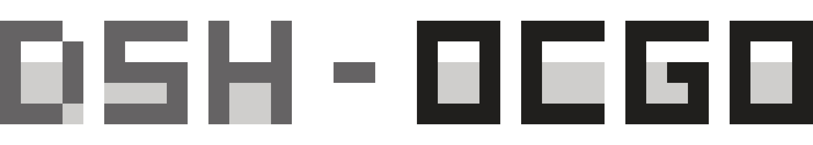
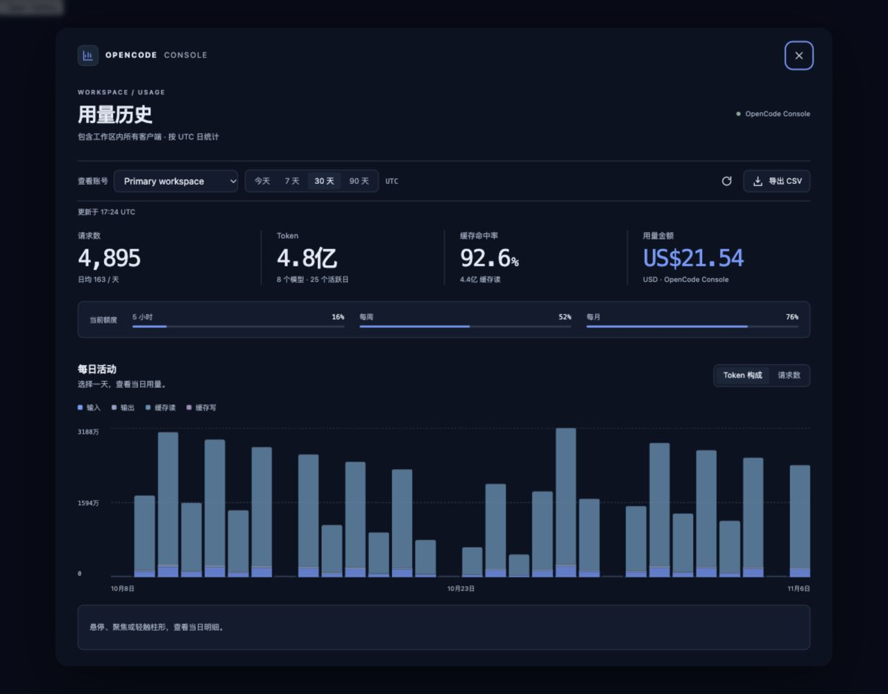
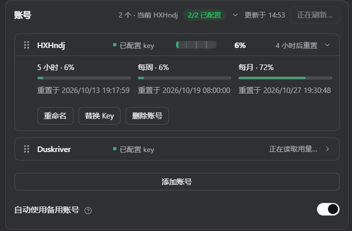
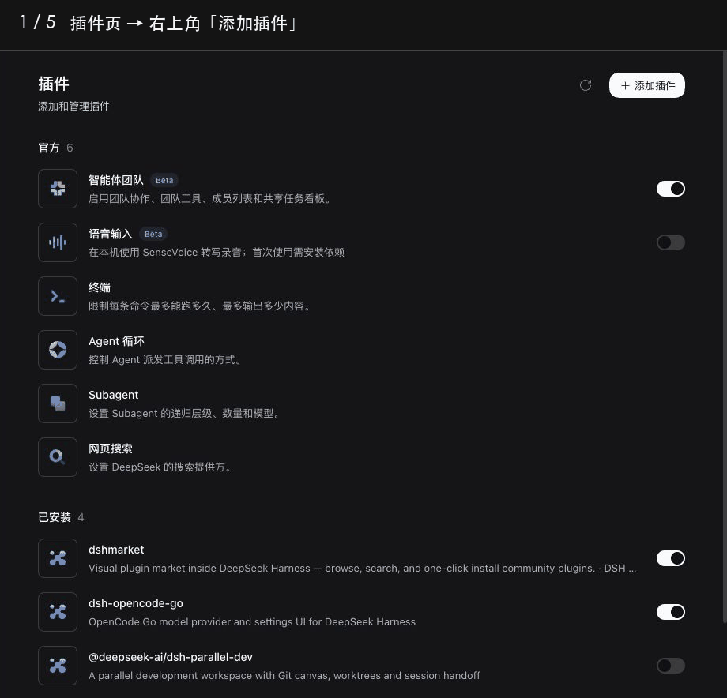
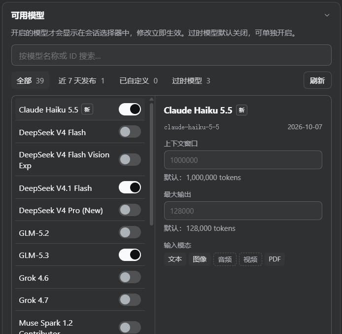
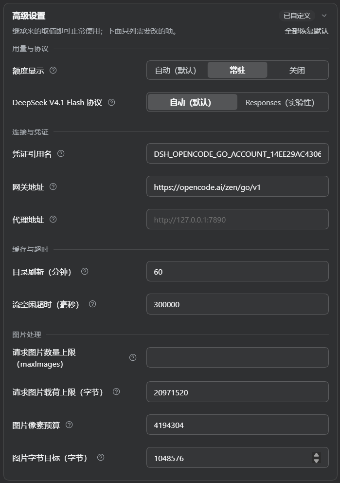

<p align="center">
  <picture>
    <source media="(prefers-color-scheme: dark)" srcset="docs/assets/logo-dark.png">
    
  </picture>
</p>

<h1 align="center">dsh-opencode-go</h1>

<p align="center">
  <a href="README.md">简体中文</a>
</p>

**OpenCode Go subscription usage and multiple-account management** for [DeepSeek Harness](https://github.com/deepseek-ai/deepseek-harness), with convenient access to quotas, reset times, and account switching.

DSH already supports OpenCode Go natively. This plugin focuses on usage inside conversations, managing multiple accounts, and dedicated model and settings controls.

- **Independent Go and Free routes**: dynamically discover each gateway’s chat models, keep overlapping IDs, and edit them in separate settings tabs. Free shares saved keys and uses public access when none is usable.
- **Usage at a glance**: see usage beside the conversation input, then open the panel for five-hour, weekly, and monthly percentages and reset times.
- **Accounts in one place**: inspect each account's quota and key status, drag to reorder, switch inside a conversation, or enable automatic fallback.
- **Clearer model and settings controls**: search and filter models, adjust visibility, limits, and thinking budgets; advanced settings are grouped by purpose, with hints and a reset action.

Supports Chinese and English, following DSH's interface language. The screenshots below show the Chinese interface.

## View subscription usage

Click the usage pill beside the conversation input to open the current account's subscription usage. Bars show the **percentage used**, turn amber near the limit, and red when exhausted. Each quota window shows its reset time.

While visible, usage refreshes every minute. Periodic queries pause while the page is hidden and resume with a refresh when it becomes visible. Temporary failures show a warning; retained readings are marked as previous data. Click **Retry now** after a failure, or **Refresh accounts** in the Settings account card.

Under **Settings → OpenCode Go → Advanced settings → Usage display**, choose:

| Mode | Behavior |
| --- | --- |
| Auto (default) | Show while a **DSH OpenCode Go** model is selected |
| Always | Also show configured OpenCode Go account usage while using other models |
| Off | Hide the conversation pill and stop its polling |

## Usage analytics

Open the dashboard from the conversation input's expanded usage pill or the sidebar dashboard button.



[Narrow-screen light preview](docs/assets/usage-history-mobile.jpg) · [Model rankings and detail](docs/assets/usage-history-models.jpg), both using sample data.

- **One official source**: totals, daily charts and model detail use the same official daily CSV, covering requests, input/output/cache tokens and the official usage amount. Models are grouped by provider + model. Ranges are today, 7, 30 and 90 days; all dates use UTC.
- **Independent viewing account**: defaults to the current inference account and shows only the workspace belonging to the selected key, including calls from other clients. Changing the viewing account does not change the conversation account. All three dashboard quota windows follow the selection. Anonymous Free coverage is not guaranteed.
- **Official usage amount**: sums `cost_micro_cents` directly (`1 USD = 100,000,000` units); it does not mean an additional Go charge. Official daily aggregates may be delayed.
- **One palette**: ink blue / cool white with cobalt accents follows the Host's light/dark mode. A wide-screen dialog becomes full-screen on narrow screens, with stacked token or request bars by day, model rankings and detail. Account and model settings retain Host components.
- **On-demand queries**: history loads when opening, changing account or range, or refreshing manually. The Host uses a 30-second cache; forced refresh bypasses it. History is not polled in the background. Only official model gateway configurations support it; errors remain explicit without falling back to local scans.

Keys stay on the Host. Normal reports send the browser only aggregate numbers and provider / model / day; an official CSV explicitly downloaded by the user may contain member fields. See [usage analytics notes](docs/usage-analytics.en.md) for accounting and privacy details.

## Manage multiple accounts

Open **Settings → OpenCode Go → Accounts** to manage accounts:



- Add, rename, replace keys, or remove accounts; up to 20 accounts are supported.
- See key status, five-hour usage, and a reset countdown in each row; expand it for full usage and account actions.
- Drag a row's handle to reorder accounts. The first row becomes current, and the order determines automatic fallback priority.
- Click **Switch** in the conversation usage panel to move the selected account first for subsequent requests in this profile. The other accounts keep their relative order.

With **Automatic fallback** enabled, HTTP 401/403/429 or exhausted quota causes the plugin to try other accounts in order before output begins. A fallback account that starts producing output moves first and becomes current, and the usage panel shows a switch notice. Requests that have already produced output, recorded token usage, or been canceled are not automatically resent through another account.

Gateway-rejected keys cool down in memory for five minutes. Account commands write credentials and settings through one serial host queue.

Keys are saved through DSH's credential service. Settings never displays an already saved key.

## Install and get started

Requires DSH `0.2.1-rc.5` or later. See [development](docs/development.md) for the current validation workflow.

### Install from DSH

1. Open **Plugins → Add plugin**.
2. Enter `dsh-opencode-go` and click **Install**.
3. Click **Enable now** after installation.



You can also enter the repository URL:

```text
https://github.com/Duskriver/dsh-opencode-go
```

Command-line installation:

```sh
dsh plugin --profile web add dsh-opencode-go
```

Start or restart `dsh web` after command-line installation. Web and Headless use separate profiles; install and update each individually.

### Get started

1. Open **Settings → OpenCode Go → Accounts**, click **Add account**, enter a name and your OpenCode Go subscription API key, and confirm.
2. Select a model under **DSH OpenCode Go** in the conversation model picker.
3. Start chatting and check usage beside the input. With multiple accounts, open the panel to switch.

The plugin registers its own **DSH OpenCode Go** model provider. Selecting a native DSH provider does not automatically use this plugin's account switching. **Always** mode can still show usage for accounts configured in this plugin.

## Models and settings

### Select models and adjust parameters

Search **Available models** by name or ID, or filter by **New in 7 days**, **Customized**, or **Deprecated**. Click **Refresh** to check the latest catalog.



- Each model's switch controls its visibility in the conversation picker and takes effect immediately.
- Select a model to inspect its catalog context window, maximum output, and input modalities. Save limit overrides to apply them; empty values use defaults.
- Reasoning models offer the applicable switch, effort, or token budget options. Budget-based models also accept custom budgets that become available after saving.

Any model with an output capacity above **65,536 tokens** defaults to that allowance when neither the caller nor settings specifies one. Smaller models retain their SDK defaults. DSH receives the same allowance for compaction budgeting. Set a model’s **Max output** override when a longer answer is needed.

Streaming, reasoning, tool calls, and image input depend on model capabilities. Input modalities shown in Settings come from online model metadata; this plugin currently converts and forwards only image attachments.

### Grouped advanced settings

Advanced settings are grouped into **Usage settings**, **Connection**, **Cache and timeouts**, and **Image handling**. Hover over a question mark for help. **Reset all to defaults** clears the card's custom overrides; save to apply the reset. The current account selection is preserved.



HTTP, HTTPS, and SOCKS5 proxies are supported. After saving, subsequent conversations, catalog updates, and usage queries use the proxy. Connections originate from the machine running DSH; on a remote deployment, `127.0.0.1` refers to that server.

Set `baseURL` and `freeBaseURL` independently under Connection. Protocol selection follows the gateway model declaration. See the [advanced guide](docs/advanced.en.md) for account, model-key and disk-cache details.

Screenshots illustrate the interface. Actual models, quotas, and timestamps depend on your account and the current online catalog.

## Updates and common questions

Update to the latest npm release:

```sh
dsh plugin --profile web update dsh-opencode-go --latest
```

Restart `dsh web` and reload the page afterward. For desktop DSH, quit and reopen the application. Headless users should replace `web` with `headless`. The repository's default branch may contain changes not yet released to npm.

**Why is usage hidden?** Auto mode shows it only for **DSH OpenCode Go** models. Check that the plugin is enabled, a key is configured, and the display mode is appropriate. Choose Always to show usage with other providers.

**What if usage queries or account additions fail?** Retry in the usage panel or refresh usage in the account card. Account actions run in a serial host queue; unsuccessful operations can be retried. See [account operations and saving](docs/advanced.en.md#account-operations-and-saving).

**What if a long conversation keeps returning 400?** Check the output allowance and context window in the error, then run `/compact` or lower that model's **Max output** before retrying. Explicit context overflow is passed to DSH's recovery mechanism; an unexplained 400 keeps its classification and includes troubleshooting guidance. Failed attempts without measured tokens omit zero usage so they do not report an empty context.

**Why does an old conversation need its model selected again?** When upgrading from `0.1.16` or earlier, select **DSH OpenCode Go** again in existing conversations or Agent presets. Manual configurations use `provider: dsh-opencode-go`.

**Which host is targeted?** The development baseline is DSH `0.2.1-rc.5`. Developer messages, dynamic tool additions/removals, and deferred tool loading are explicitly rejected; see [development and testing](docs/development.md).

Uninstall:

```sh
dsh plugin --profile web remove dsh-opencode-go
```

## Architecture and verification

The source is organized by domain:

| Domain | Modules |
| --- | --- |
| Plugin composition, settings and contracts | `index.ts`, `config.ts`, `contracts.ts` |
| Requests, model catalog and protocol conversion | `adapter.ts`, `catalog.ts`, `conversion.ts`, `google.ts`, `sdk-types.ts` |
| Accounts, official quota, official CSV history and transport | `accounts.ts`, `analytics.ts`, `transport.ts` |
| Browser registration and typed state | `client/index.ts`, `client/controller.ts` |
| Host settings, account/model controls, usage and copy | `client/Section.tsx`, `client/UsagePill.tsx`, `client/AnalyticsDialog.tsx`, `client/presentation.ts` |

The browser uses DSH's `configForms`; capacities remain typed objects while editing. Images use per-request count and encoded-byte budgets, with at most four preparations per request. The package keeps its `.` and `./client` exports. Development dependencies pin DSH `0.2.1-rc.5` and Cordis `4.0.5`; runtime Cordis requires `~4.0.5`.

Use Node.js `^22.19.0 || >=24.0.0`:

```sh
npm ci
npm test
npm run typecheck
npm run check:dist
npm run verify
```

Tests cover host services, accounts, catalog, protocols, analytics, transport and browser interactions. After changing source, run `npm run compile` to rebuild `lib/`. `verify` runs type checks, artifact comparison, the full test suite and the package-loading smoke. See [development](docs/development.md) for separate installed-consumer and Headless checks.

## More documentation

- [Advanced guide: Headless, proxies, manual configuration, and error diagnostics](docs/advanced.en.md)
- [Usage analytics: official source, accounting, and privacy](docs/usage-analytics.en.md)
- [Development and testing](docs/development.md)
- [Verification notes](docs/verification.md)
- [Issues and suggestions](https://github.com/Duskriver/dsh-opencode-go/issues)
- [MIT license](LICENSE)
