<p align="center">
  <picture>
    <source media="(prefers-color-scheme: dark)" srcset="docs/assets/logo-dark.png">
    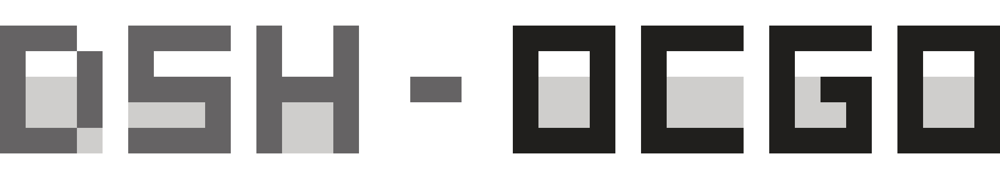
  </picture>
</p>

<h1 align="center">dsh-opencode-go</h1>

<p align="center">
  <a href="README.md">简体中文</a> · <a href="#-highlights">Highlights</a> · <a href="#-quick-start">Quick Start</a> · <a href="#-faq">FAQ</a> · <a href="docs/advanced.en.md">Advanced Guide</a> · <a href="docs/development.md">Development</a>
</p>

**OpenCode Go provider, live quota visibility, smart request-budget estimation, and multi-account failover** for [DeepSeek Harness (DSH)](https://github.com/deepseek-ai/deepseek-harness).

DSH supports OpenCode Go natively, but power users and multi-account workflows need more: **in-conversation quota pills with remaining-call estimates, automatic pre-output account failover, session-level prompt-cache affinity, an official workspace history dashboard**, and an **all-in-one sidebar console**. Built on Cordis, this plugin delivers full protocol conversion alongside a cohesive client UI.

> Supports Chinese and English, following DSH's interface language. The screenshots below show the default **DSH Native (Dark)** theme in Chinese (real redacted DSH Desktop captures alongside real plugin component views with sample data); you can switch to **OpenCode Go Classic** at any time under **Appearance**, and both themes follow the Host's light/dark scheme.

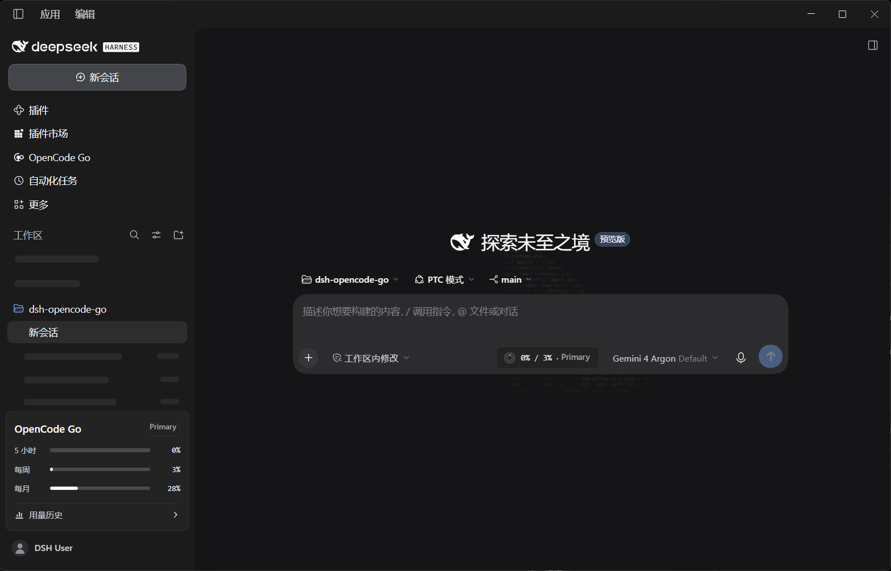

---

## ✨ Highlights

- 🧭 **Sidebar Console (7 Sub-pages, opt-in)**: Enable **Sidebar entry** to add a hand-drawn `go` stone entry right after the plugin market in DSH's sidebar, opening a full-page console (**Overview / Usage / Accounts / Models / Appearance / Advanced / About**) sharing one state controller with Settings. Off by default; older hosts automatically stay on Settings + the in-place history dialog.
- 🧮 **Smart Per-Model Call Estimation**: Assign each account's OpenCode Go tier (`Go ($10)` / `Go Plus ($40)` / `Go Teams ($20)`). Combining gateway `/models` rates, monthly tier caps, and the three quota windows, the plugin displays **full-capacity request budgets** in the model detail card and **live remaining calls** (`~N calls left`, with `Peak` / `Off-peak` badges for time-of-day models) inside the conversation quota popover.
- 📊 **5 Input Quota Pill Styles + Border Toggle**: Keep subscription usage beside the chat composer in **Badge (default), Concentric rings, Level fill, Dual mini-bars, or Minimal rings** with an independent **Show border** toggle, background sleep-saving, and one-click account switching.
- 🛡️ **Automatic Multi-Account Failover**: Manage up to 20 accounts with drag-to-reorder priority. On HTTP `401/403`, `429`, or exhausted quota, the plugin silently retries backup accounts **before output starts**, promotes the working account, and cools down rejected keys for 5 minutes.
- 💰 **Official Workspace History Dashboard**: Powered directly by OpenCode Console's daily CSV across all clients in the selected workspace (UTC calendar days), with today / 7 / 30 / 90-day ranges, stacked daily charts, model breakdowns, and CSV export.
- 🆓 **Dual Dynamic Model Catalogs (Free is opt-in, off by default)**: Go and platform Free routes discover models independently from their `/models` endpoints, preserve overlapping IDs, support one-click **Enable all / Disable all** batch toggles and capacity/thinking overrides, and enforce Free `Retry-After` cooldowns without ever rotating Go accounts.
- ⚡ **Prompt-Cache Affinity & Single Save Gesture**: Sends a normalized `x-opencode-session` header to maximize gateway prompt-cache hits. Only **Advanced settings** stage changes behind Save/Discard — every other toggle, theme, pill style, tier, account, and model edit applies immediately.

---

## 🚀 Quick Start

Requires DSH `0.2.1-rc.5` or later. See [development](docs/development.md) for the validation workflow.

### 1. Install the plugin

> 💡 **Release note**: The current repository release is **`0.4.6`** (including the 7-tab sidebar console, per-model call estimation, 5 input quota pill styles, model pricing & batch switches, and `#94` fixing collapsed settings panels in auto-height shells such as DS Bot). If npm has not synced the latest build yet (for instance, npm still serves `0.4.0`), prefer **Option A** below using the tracked [`dsh-opencode-go-0.4.6.tgz`](dsh-opencode-go-0.4.6.tgz) at the repository root.

#### Option A: Manual install from the tracked `.tgz` tarball (recommended for latest release / DS Bot & Desktop)

1. **Download the `.tgz` package**: Download [`dsh-opencode-go-0.4.6.tgz`](dsh-opencode-go-0.4.6.tgz) ([direct raw link](https://github.com/Duskriver/dsh-opencode-go/raw/main/dsh-opencode-go-0.4.6.tgz)) to a space-free local folder (e.g. `C:\Users\<user>\Downloads\dsh-opencode-go-0.4.6.tgz` or `~/Downloads/dsh-opencode-go-0.4.6.tgz`). If you cloned this repo, the tarball is already in the root directory.
2. **Install via DSH / DS Bot UI**: Go to **Plugins → Add plugin** (remove any older `dsh-opencode-go` entry first — your saved keys and settings are preserved), paste the full local path to the `.tgz` file, click **Install → Enable now**, and **fully restart** the desktop app or `dsh web`.
3. **Or install via CLI**:
   ```sh
   # Web profile (replace with your local .tgz path)
   dsh plugin --profile web add ./dsh-opencode-go-0.4.6.tgz

   # Headless profile
   dsh plugin --profile headless add ./dsh-opencode-go-0.4.6.tgz
   ```
   *See the [advanced guide](docs/advanced.en.md#manual-installation-and-offline-updates-tgz) for troubleshooting `ERR_PNPM_MISSING_TARBALL_INTEGRITY` and offline updates.*

#### Option B: Install from npm (when npm has synced the latest release)

1. Open **Plugins → Add plugin**, enter `dsh-opencode-go`, and click **Install → Enable now**.
2. Or run `dsh plugin --profile web add dsh-opencode-go` and restart `dsh web`.

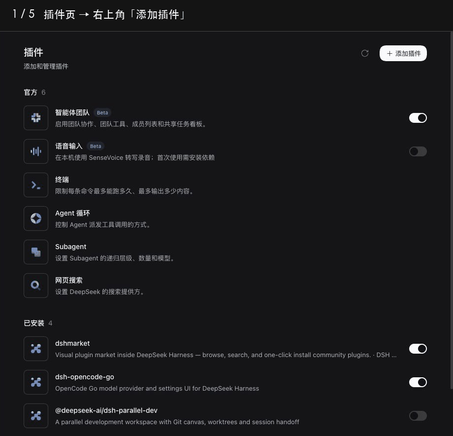

### 2. First-time setup

1. After restarting, open **Settings → OpenCode Go** and verify the version reads `0.4.6`.
2. Under **Accounts**, click **Add account**, enter a name and your OpenCode Go API key, and select your **Subscription plan** (for display-only request-count estimates).
3. *(Optional)* Under **Overview**, enable **Sidebar entry** to add the hand-drawn `go` row to DSH's sidebar and unlock the full 7-tab console.
4. Select any model under **DSH OpenCode Go** in a conversation and check live usage right beside the composer.

> **Single Save gesture**: Only **Advanced settings** (gateway URLs, proxy, timeouts, and image budgets) require clicking **Save**; every other toggle and option applies immediately.

---

## 🧭 Sidebar Console (7 Sub-pages)

Enabling **Settings → OpenCode Go → Overview → Sidebar entry** (`sidebarEntry`, off by default) registers a hand-drawn `go` stone entry after the plugin market in DSH's sidebar (the Settings nav row uses the same mark). Clicking it opens a full-page console in the main area:

<p align="center">
  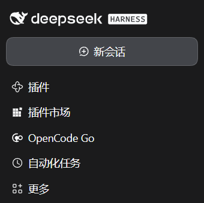
</p>

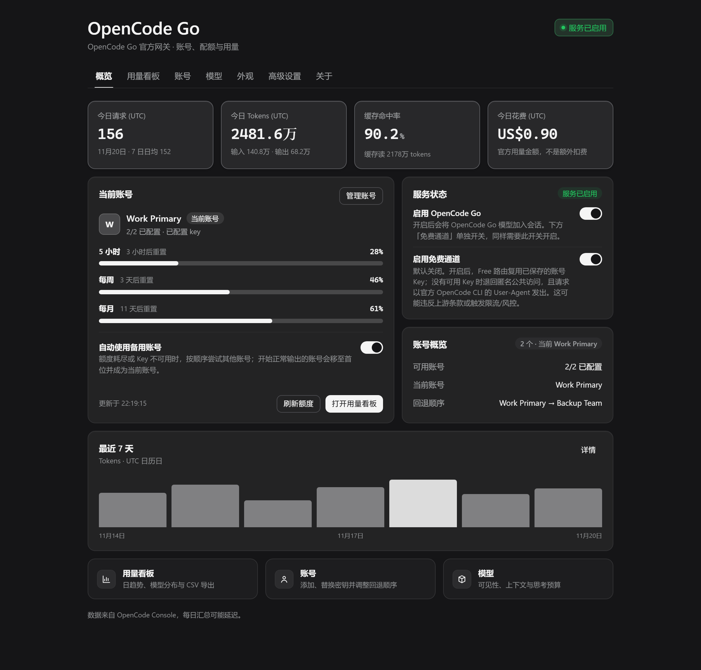

| Tab | What it covers |
| :--- | :--- |
| **Overview** | UTC today's 4 KPIs (requests, tokens, cache hit rate, spend), current account 3-window quotas & auto-failover switch, Go / Free service status, fallback chain summary, 7-day token sparkline, and quick-link cards |
| **Usage** | Full-page official workspace history dashboard with daily stacked token/request charts, model distribution rankings, detail table, and official CSV export |
| **Accounts** | Add/rename/replace key/remove accounts, drag-to-reorder priority, per-account subscription tier selector, expanded Bento 3-window quota tiles, and automatic fallback |
| **Models** | Independent Go / Free tabs, search & filters, one-click **Enable all / Disable all**, full-capacity request estimates, gateway pricing details, and context / max-output / thinking-budget overrides |
| **Appearance** | Live **DSH Native / OpenCode Go Classic** theme preview, usage display mode, 5 input pill styles + border toggle preview, and sidebar quota toggle |
| **Advanced** | Go / Free gateway URLs, HTTP(S)/SOCKS5 proxy, catalog refresh & timeout controls, and per-request image budgets (the only tab backed by the Save/Discard bar) |
| **About** | Version, package & host metadata, sidebar slot status, live runtime diagnostics (service, Free, history, account count, last refresh), and project links |

- **Graceful fallback**: When the entry is off, or on hosts without the `sidebar.panellist` slot, no sidebar row is registered — Settings keeps full controls and the composer pill's **Usage history** button opens the built-in history dialog. Disabling the switch cleanly leaves the page before unregistering the slot pair.

---

## 🧮 Smart Per-Model Call Estimation

OpenCode Go shares **percentage-based quotas across three windows** (5-hour, weekly, and monthly), which makes it hard to tell at a glance how many calls remain for a specific model. Using gateway-published tariffs, tier caps, and live multiplier schedules, the plugin translates percentages into concrete request estimates across three views:

1. **Per-account subscription tier (display-only)**
   Under **Accounts**, choose each account's OpenCode Go plan: `Go ($10)`, `Go Plus ($40)`, or `Go Teams ($20)`. This setting is strictly for UI conversion and never alters requests or upstream billing.
2. **Full-capacity request budgets in the Model card**
   Selecting any Go model under **Models** shows its estimated full-capacity calls across the 5-hour (`20%`), weekly (`50%`), and monthly (`100%`) caps using a **typical cached coding-agent request profile** (`1K input + 44K cache read + 450 output`), plus a peak-hour multiplier note when scheduled multipliers apply.
3. **Live remaining calls in the composer Usage Pill popover**
   Opening the conversation usage popover computes `~N calls left` (or `0 calls left`) for the **active Go model** based on the tightest bottleneck window and any active UTC time-of-day multiplier (displaying a `Peak` or `Off-peak` badge with multiplier details on hover).

<p align="center">
  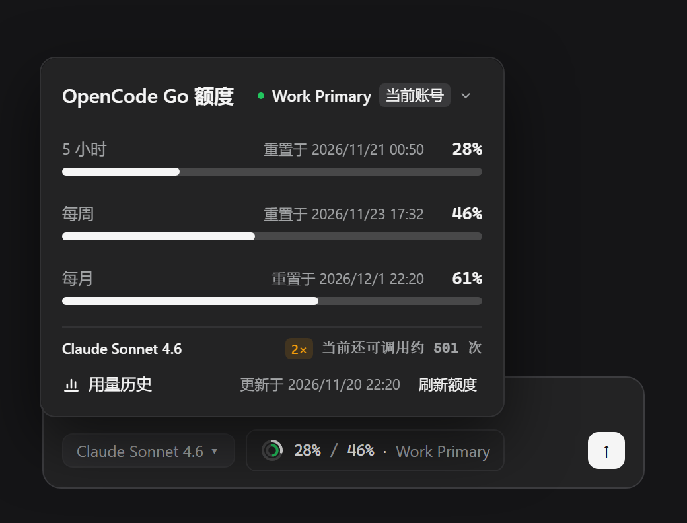
</p>

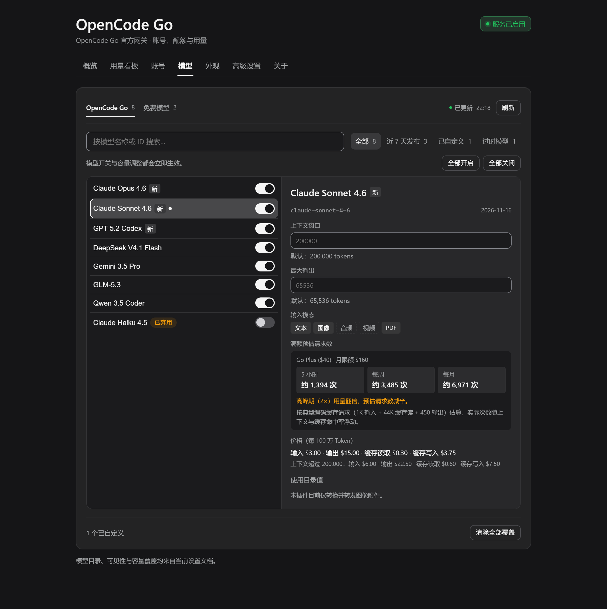

> Actual call counts vary with conversation length and prompt-cache hit rates; treat estimates as practical planning guidance.

---

## 📊 Input Quota Pill & Appearance

Open **Appearance** (in the console or Settings — all changes apply immediately):

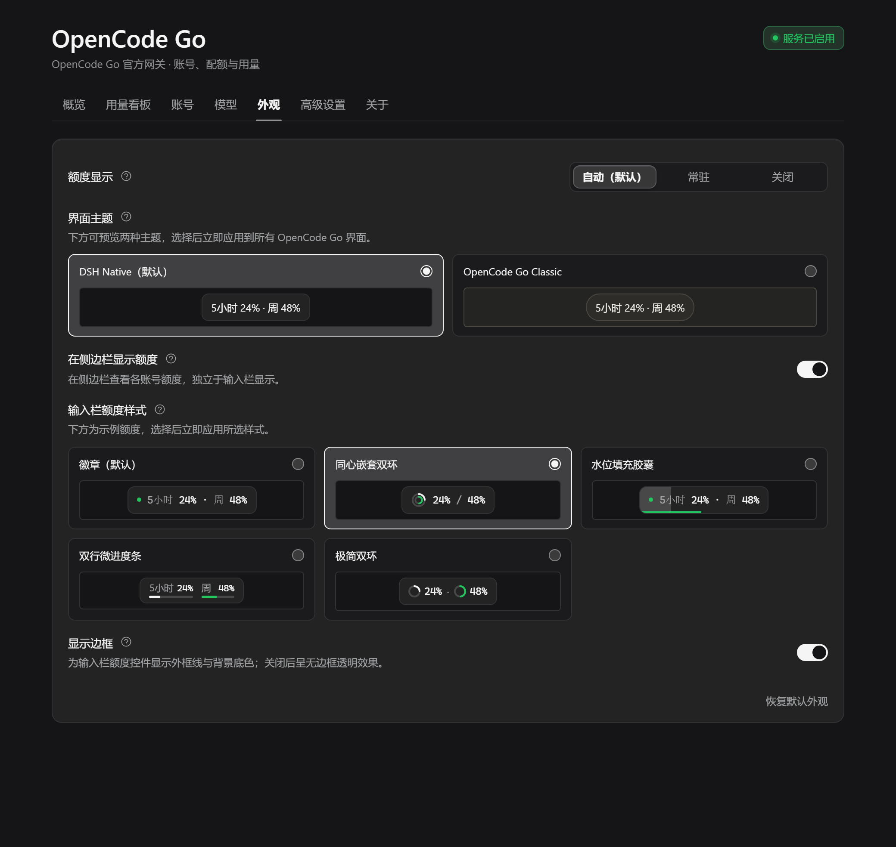

- **5 input quota styles + independent border toggle**:
  - Choose from **Badge (default)**, **Concentric rings**, **Level fill**, **Dual mini-bars**, and **Minimal rings** with live previews.
  - Combine any style with **Show border** (on for framed pill fill, off for a borderless transparent look).
- **Display modes & smart polling**:
  - **Auto (default)** shows the pill only for **DSH OpenCode Go** models; **Always** keeps it visible with other providers; **Off** hides it and stops polling.
  - Polls quietly every minute while visible, pauses when the page is hidden, and refreshes immediately on return. Click the account chip in the popover to switch accounts without leaving the chat.
- **Independent sidebar quota card**: Enable **Show quota in the sidebar** to see all three windows in the expanded sidebar (or a compact icon when collapsed); click the account badge to cycle through accounts read-only without changing the active inference account.
- **Two cohesive themes (`appearanceTheme`)**:
  - **DSH Native (default)**: Follows DSH and third-party themes via public Host semantic tokens while keeping strong control borders and chart state series on contrast-checked WCAG 1.4.11 (≥ 3:1) values.
  - **OpenCode Go Classic**: Keeps warm paper / charcoal surfaces, terracotta accents, and serif/sans/mono typography while still following the Host's light/dark scheme.

---

## 🛡️ Multi-Account Management & Failover

Manage up to 20 accounts under **Accounts**:

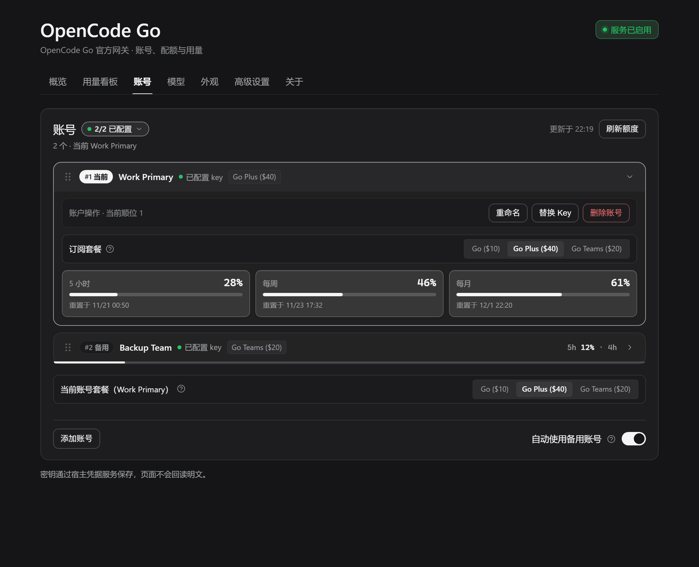

- **Drag order = priority**: `#1 Current` serves active requests; drag handles reorder both primary selection and fallback order. Expand any row for Bento 3-window quota tiles, reset times, per-account plan selection, and rename / replace key / remove actions.
- **Pre-output automatic fallback**: With **Automatic fallback** enabled, HTTP `401/403`, `429`, or exhausted quota triggers silent retries across backup accounts **before output begins**. The first backup account that produces output moves to `#1` and posts a switch notice in the usage panel. Requests that already streamed output, recorded usage, or were canceled are never re-sent.
- **5-minute cooldown & credential isolation**: Rejected keys cool down in memory for 5 minutes to avoid retry storms. Keys live exclusively in DSH's credential service and are never echoed back to the UI.

---

## 💰 Official Workspace History Dashboard

Open the **Usage** tab in the sidebar console for the full-page view (or click **Usage history** in the composer pill to open the built-in dialog when the sidebar entry is off or unsupported):

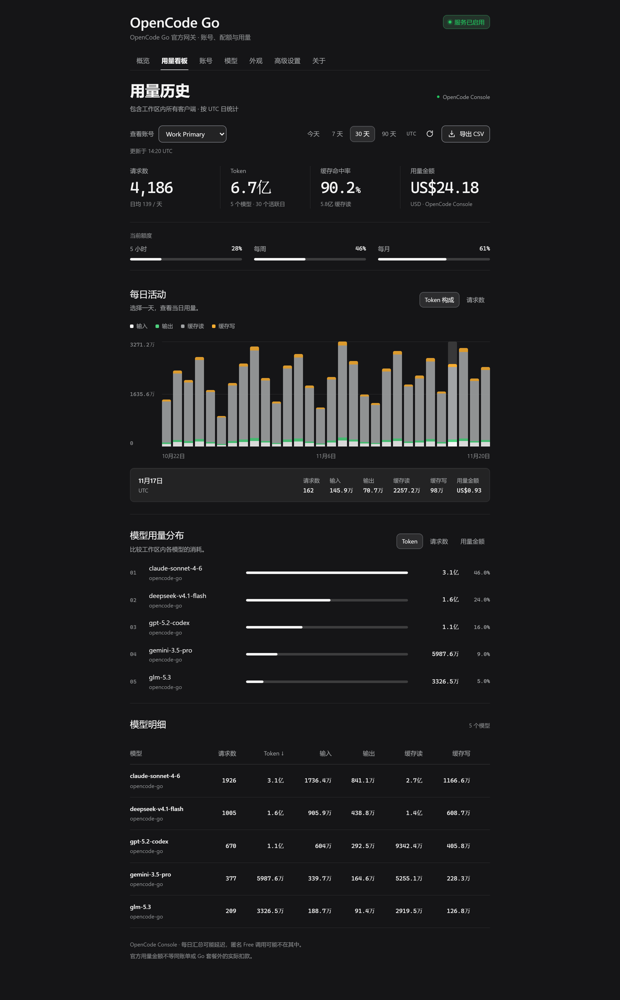

- **Single official CSV source**: Requests, input/output/cache tokens, official usage amount (summed directly from `cost_micro_cents`, where `1 USD = 100,000,000` units — not an extra Go charge), daily charts, and model tables all come from OpenCode Console's daily UTC CSV across **Today / 7 / 30 / 90 days**, with one-click **Export CSV**.
- **Independent viewing account**: Defaults to the active inference account and covers all clients in that key's workspace; switching the viewed account updates the three quota bars without changing your conversation account.
- **On-demand & privacy-first**: Fetches only on open, account/range change, or manual refresh (30-second Host cache, no background polling). Keys never leave the Host; regular reports send only aggregate figures and `provider / model / day` to the browser (explicitly exported CSVs may include member fields). See [usage analytics notes](docs/usage-analytics.en.md).

---

## 🆓 Free Channel (opt-in, off by default)

`DSH OpenCode Free` is an explicit opt-in and defaults to **off** to avoid unintended usage or ToS exposure. Enable it under **Overview → Free channel** (applied immediately, or set `freeEnabled: true`). While off, the plugin neither registers `dsh-opencode-free`, fetches `freeBaseURL`'s catalog, nor exposes Free models; turning it off withdraws the route while allowing in-flight streams to finish.

When enabled:

- **Endpoint-bound key reuse**: Saved Go keys are reused (and follow Automatic fallback) only when `freeBaseURL` is the official HTTPS endpoint (`https://opencode.ai` on default port) or shares the exact origin of `baseURL` (e.g., a shared reverse proxy). Any other custom or plaintext HTTP `freeBaseURL` falls back to anonymous `Bearer public` without reading or sending saved keys.
- **Official CLI UA & isolated Bun runtime**: Requests use the official OpenCode CLI user agent (`opencode/latest/2.2.5/cli`) through a dedicated HTTP worker launched from version-pinned `@oven/bun-*@1.4.4` optional platform packages (native binaries directly, no `postinstall` build scripts).
- **Isolated rate-limit cooldown**: Honors upstream `Retry-After` and fails fast with `FREE_COOLDOWN`; shared Free quota or IP limits never rotate Go accounts.

> ⚠️ **Risk**: The Free channel relies on the upstream public Free entry point with an official CLI user agent. It may violate upstream terms of service or trigger rate limits / account restrictions. Use at your own discretion and avoid production or large-scale automation.

---

## ⚙️ Model Overrides & Advanced Settings

### Model Catalog & Capacity Overrides

Under **Models** (see screenshot above), manage **OpenCode Go** and **Free** catalogs separately:

- **Visibility & batch toggles**: Non-deprecated models are enabled by default and deprecated ones default to disabled. Search by name/ID, filter by **New in 7 days / Customized / Deprecated**, and use **Enable all / Disable all** for atomic single-click updates across the current view (skipping `configurationMissing` models), with independently scrollable list and detail panes.
- **Pricing & capacity edits**: Inspect `/models` input / output / cache-read / cache-write rates, context-tier pricing, and multiplier notes in the detail card (Free models display **Free**). Override context window, max output, and custom thinking budgets live with no restart.
- **Default output safety cap**: Any model advertising an output capacity above `65,536` defaults to **`65,536 tokens`** unless overridden by caller or settings (reported to DSH for compaction budgeting); smaller models keep their SDK defaults.

### Grouped Advanced Settings (the only Save-gated tab)

Open **Advanced** to tune connection, timeout, and image parameters (click **Save** in the bottom bar to apply):

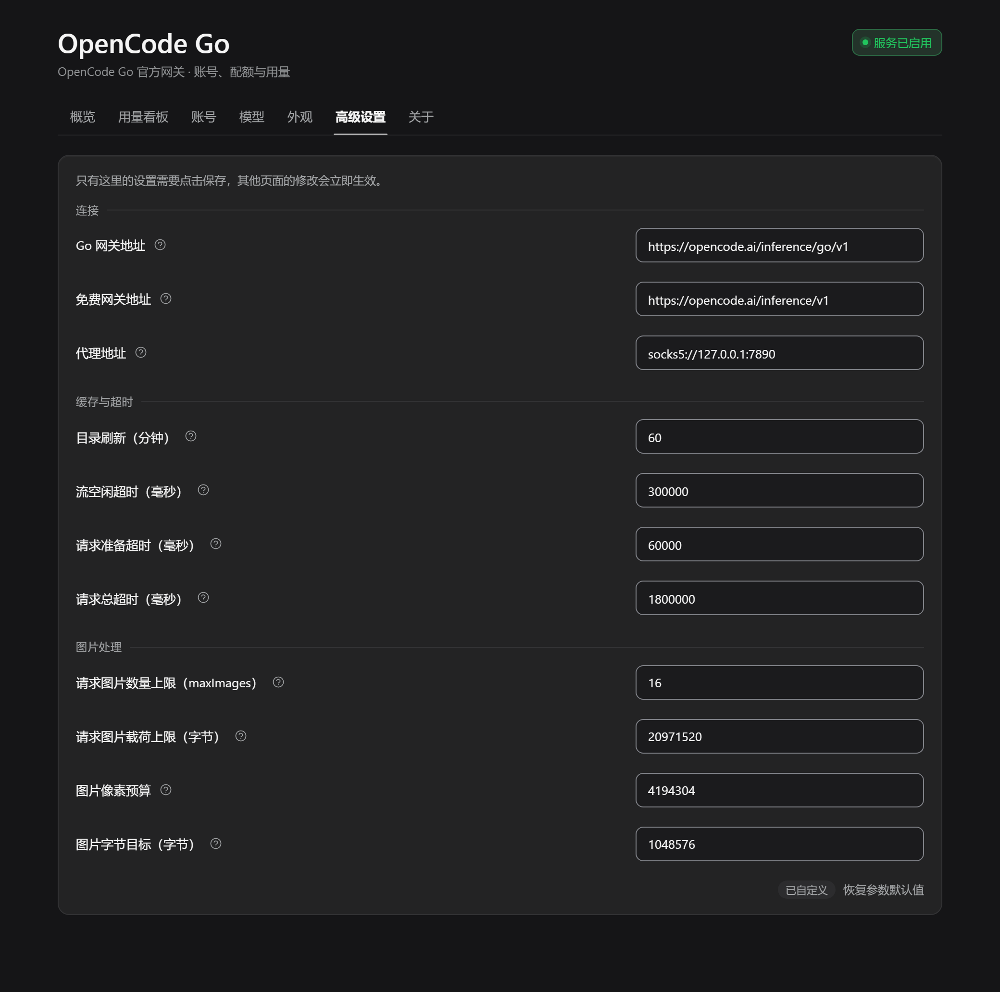

- **Connection & Proxy**: Configure `baseURL`, `freeBaseURL`, and **HTTP / HTTPS / SOCKS5** proxies (`socks5://127.0.0.1:7890`), applied to conversations, usage polling, history analytics, and catalog discovery.
- **Cache & Timeouts**: Tune catalog refresh interval, `streamIdleTimeoutMs`, `requestPreparationTimeoutMs`, and `requestTimeoutMs`.
- **Request Retry**: Configures the Go route's host-executed retry policy (defaults to `normal` mode with a **`30,000 ms`** max delay / `Retry-After` cap to absorb common gateway rate limits); adjust retry mode, max retries, and max delay live under **Advanced** without restarting (Free keeps its passive cooldown behavior).
- **Image Handling**: Configure per-request `maxImages`, encoded payload limit, pixel budget, and target image bytes (up to 4 images prepared in parallel).
- **Reset to defaults**: Clears Advanced overrides without affecting saved accounts or credentials.

---

## 🛠️ Architecture & Verification

Source modules are organized by domain, communicating between Host and browser via DSH Typert RPC:

| Domain | Modules |
| :--- | :--- |
| Plugin composition, settings & contracts | `index.ts`, `config.ts`, `contracts.ts` |
| Inference, catalog, pricing & quota estimation | `adapter.ts`, `catalog.ts`, `pricing.ts`, `quota-estimate.ts`, `conversion.ts`, `google.ts`, `sdk-types.ts` |
| Accounts, live quota, CSV analytics & transport | `accounts.ts`, `analytics.ts`, `transport.ts` |
| Opt-in Free channel & Bun HTTP worker | `free-channel.ts`, `free-runtime.ts`, `free-transport.ts`, `free-http-worker.ts`, `free-policy.ts`, `free-protocol.ts`, `free-socks-tunnel.ts` |
| Client registration, state & host slots | `client/index.ts`, `client/controller.ts`, `client/host-slots.ts`, `client/settings-nav-icon.tsx`, `client/pages/nav.ts` |
| Sidebar console (7 sub-pages) | `client/pages/Page.tsx`, `OverviewPage.tsx`, `UsagePage.tsx`, `AccountsPage.tsx`, `ModelsPage.tsx`, `AppearancePage.tsx`, `AdvancedPage.tsx`, `AboutPage.tsx`, `types.ts`, `client/GoMark.tsx`, `client/build-info.ts` |
| Settings, quota pills, dashboard & themes | `client/Section.tsx`, `client/UsagePill.tsx`, `client/AnalyticsDialog.tsx`, `client/presentation.ts` |

The `x-opencode-session` header carries a stable form of the conversation ID for gateway prompt-cache affinity (printable ASCII IDs pass through verbatim; non-printable or reserved-prefix IDs are hashed with `sha256 + base64url`, containing no message content).

Development requires Node.js `^22.19.0 || >=24.0.0`, pinning DSH `0.2.1-rc.5` and Cordis `4.0.5` (runtime Cordis `^4.0.5`):

```sh
npm ci
npm test
npm run typecheck
npm run check:dist
npm run pack:release
npm run check:pack
npm run verify
```

Per repository policy, every change touching packed files updates the single tracked root tarball (`dsh-opencode-go-<version>.tgz`) via `npm run pack:release`, and `npm run check:pack` verifies byte-for-byte parity in CI. See [development](docs/development.md) for installed-consumer and Headless checks.

---

## ❓ FAQ

<details>
<summary><strong>Q: Why does installing by package name still give an older version (e.g. 0.4.0) or a collapsed settings panel in DS Bot?</strong></summary>

The npm registry may lag behind the repository. Download [`dsh-opencode-go-0.4.6.tgz`](dsh-opencode-go-0.4.6.tgz) locally, remove the older `dsh-opencode-go` entry (saved keys and settings remain intact), install from the local `.tgz` path, and fully restart DS Bot / DSH. See [manual installation and offline updates](docs/advanced.en.md#manual-installation-and-offline-updates-tgz).
</details>

<details>
<summary><strong>Q: Why don't I see estimated call counts on a model or in the composer popover?</strong></summary>

Estimates apply to **Go channel** models with published `/models` prices and monthly tier caps (Free or unpriced models omit estimates). The composer popover shows live remaining calls only when the active conversation model is a **DSH OpenCode Go** model and quota readings succeed. Verify each account's subscription plan under **Accounts**.
</details>

<details>
<summary><strong>Q: Why is there no OpenCode Go entry in the sidebar?</strong></summary>

The sidebar entry is opt-in and off by default. Enable **Settings → OpenCode Go → Overview → Sidebar entry** (applied immediately). On hosts that do not declare `sidebar.panellist`, the plugin keeps using Settings and the pill's built-in history dialog.
</details>

<details>
<summary><strong>Q: Why is the usage pill hidden next to the chat input?</strong></summary>

**Auto** mode displays the pill only while a **DSH OpenCode Go** model is selected. Switch **Appearance → Usage display** to **Always** (applied immediately) to keep it visible with other providers, and make sure a valid key is configured.
</details>

<details>
<summary><strong>Q: Where is DSH OpenCode Free, or why does Free report MISSING_BUN_RUNTIME?</strong></summary>

Free is opt-in and off by default — enable it under **Overview → Free channel**. Free uses `@oven/bun-<platform>@1.4.4` optional packages; if optional dependencies were skipped (`--omit=optional`), reinstall with optional dependencies enabled (Go is unaffected).
</details>

<details>
<summary><strong>Q: Why does a long conversation return HTTP 400?</strong></summary>

Context plus output allowance likely exceeded the model's context window. Run `/compact` in the conversation or lower **Max output** under **Models**. Explicit context overflow errors are handed back to DSH's native recovery flow.
</details>

<details>
<summary><strong>Q: What should I do about HTTP 429 rate limits when dispatching many parallel subagents on a single account?</strong></summary>

Dispatching many parallel subagents on the same provider/model with a single account can trigger upstream rate limiting (often returning a 15–18s `Retry-After`). The plugin defaults the Go route's retry `maxDelayMs` cap to **`30,000 ms`** (tunable under **Advanced → Request retry**, or via `retryPolicy` in a patch config). If rate limits persist, reduce subagent concurrency, stagger dispatches, or add multiple accounts with **Automatic fallback** enabled.
</details>

---

## 📦 Updates & Uninstall

### Manual update via `.tgz` (recommended when npm is behind)

```sh
dsh plugin --profile web remove dsh-opencode-go
dsh plugin --profile web add /path/to/dsh-opencode-go-0.4.6.tgz
```

*In DS Bot / DSH Desktop UI, remove the old plugin entry, add the local `.tgz` path, enable it, and fully quit and reopen the app.*

### Online update & uninstall

```sh
# Update from npm (replace web with headless for Headless profile)
dsh plugin --profile web update dsh-opencode-go --latest

# Uninstall
dsh plugin --profile web remove dsh-opencode-go
```

---

## 📚 More Documentation

- 📖 [Advanced guide (Headless, proxies, offline install, and diagnostics)](docs/advanced.en.md)
- 📊 [Usage analytics (official source, accounting, and privacy)](docs/usage-analytics.en.md)
- 🛠️ [Development and testing](docs/development.md)
- 🧪 [Verification notes](docs/verification.md)
- 📋 [Changelog](CHANGELOG.md)
- 🐛 [Issues and suggestions](https://github.com/Duskriver/dsh-opencode-go/issues)
- 📄 [MIT license](LICENSE)
