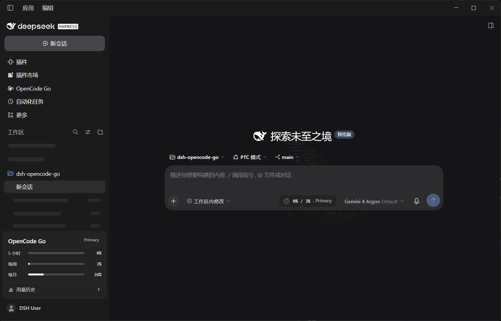
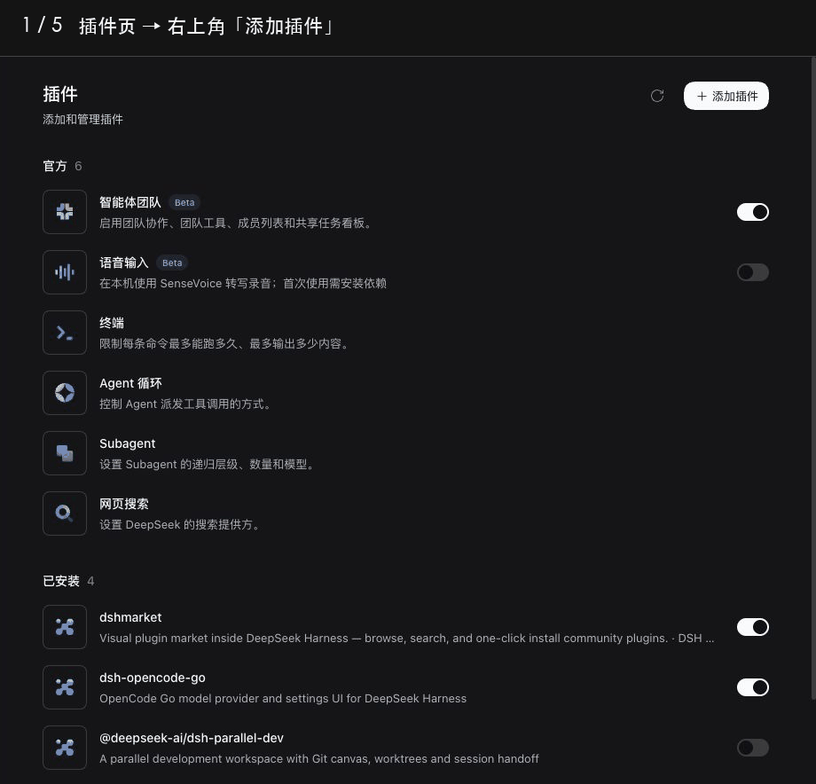
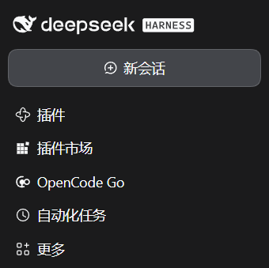
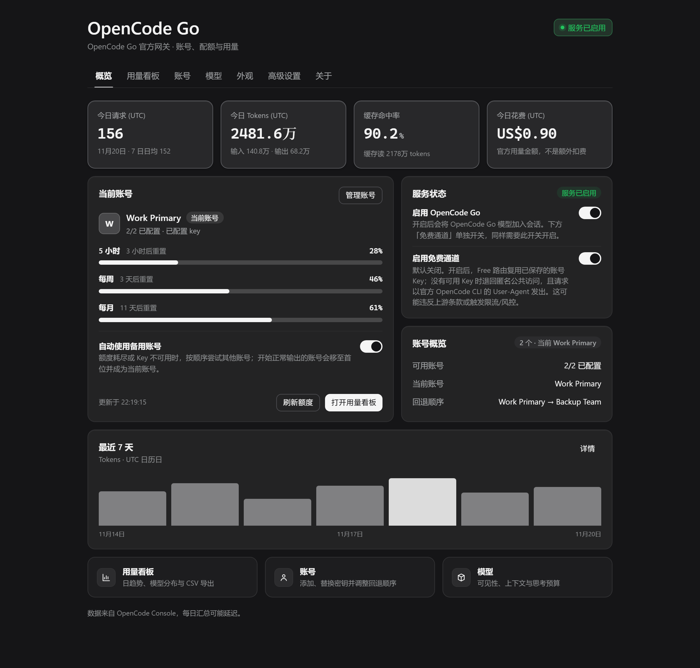
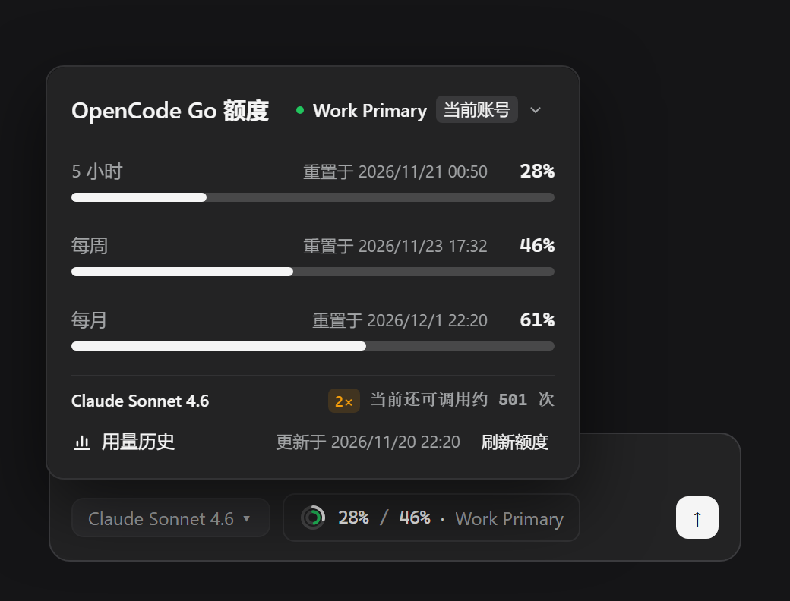
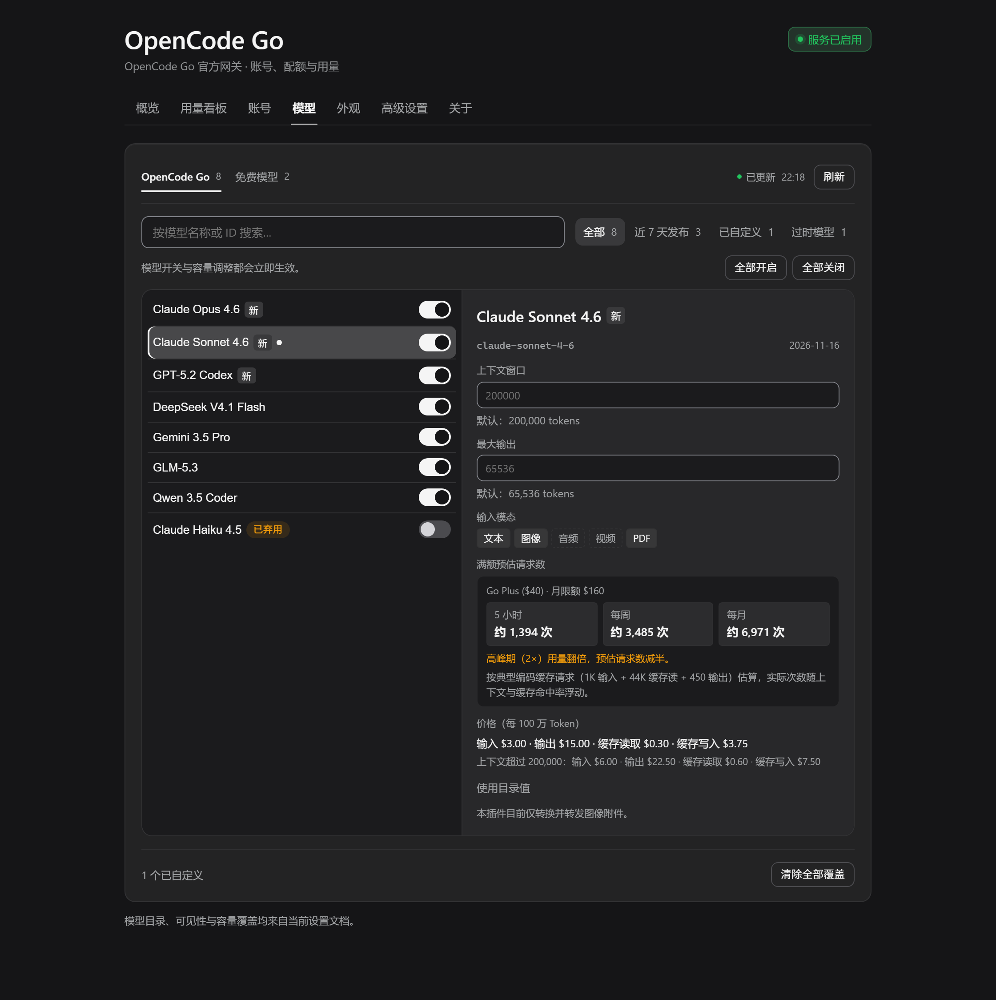
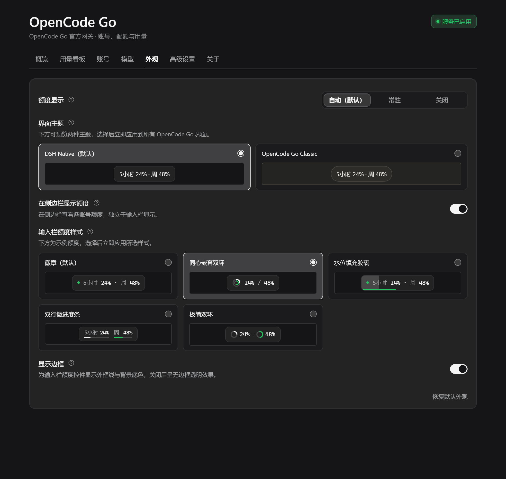
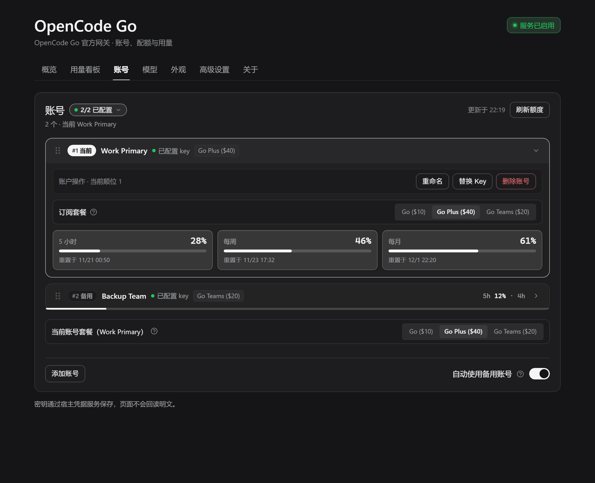
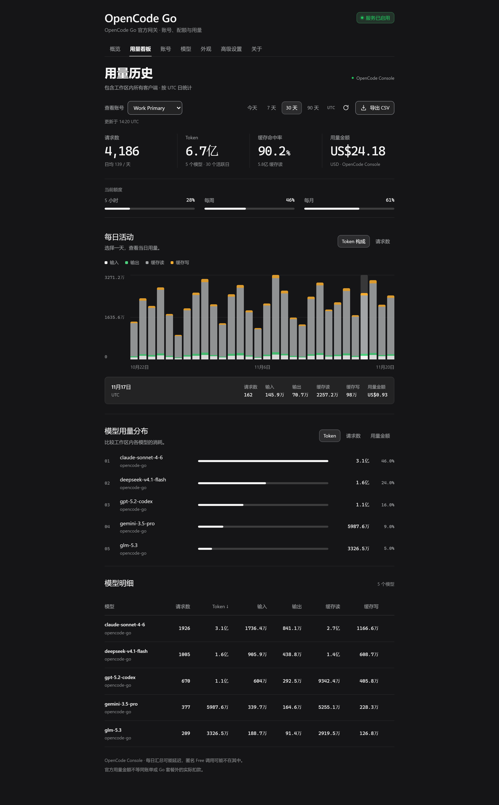
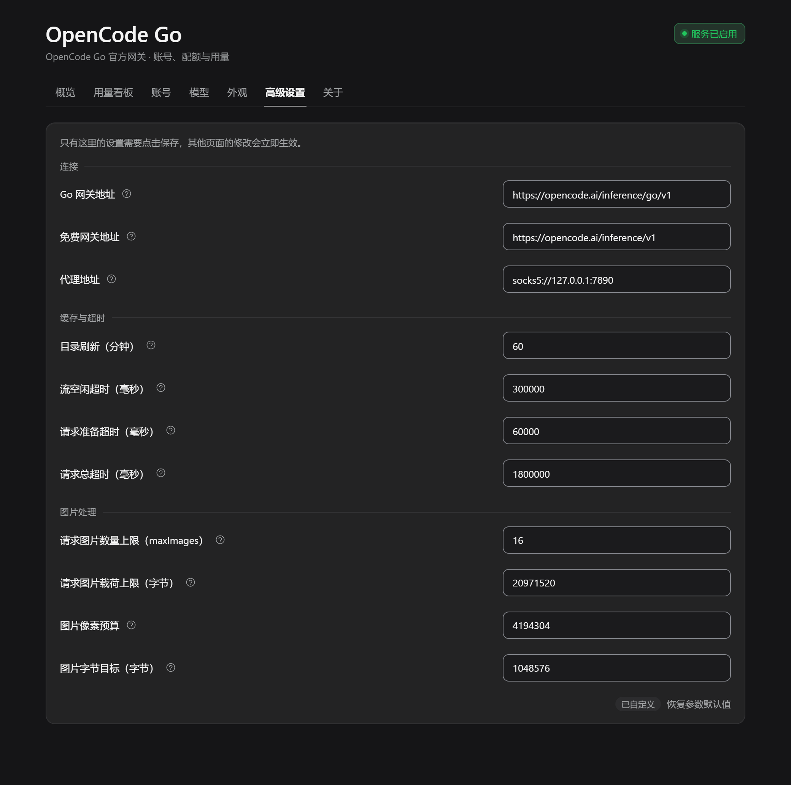

<p align="center">
  <picture>
    <source media="(prefers-color-scheme: dark)" srcset="docs/assets/logo-dark.png">
    
  </picture>
</p>

<h1 align="center">dsh-opencode-go</h1>

<p align="center">
  <a href="README.en.md">English</a> · <a href="#-核心特性">核心特性</a> · <a href="#-快速开始">快速开始</a> · <a href="#-常见问题-faq">常见问题</a> · <a href="docs/advanced.md">高级指南</a> · <a href="docs/development.md">开发与测试</a>
</p>

为 [DeepSeek Harness (DSH)](https://github.com/deepseek-ai/deepseek-harness) 量身打造的 **OpenCode Go 专属接入、配额透视与多账号管理插件**。

DSH 原生支持接入 OpenCode Go，但在高频开发与多账号协作场景下，仍缺少**会话内实时额度与剩余次数估算、多账号无感容灾、会话级 Prompt 缓存绑定、官方历史用量看板**以及**一体化控制台**。本插件基于 Cordis 微内核架构，在提供完整模型协议转换的同时，带来与 DSH 深度融合的客户端体验。

> 以下界面截图展示默认 **DSH Native（深色）** 主题；你也可以随时在「外观」中切换为 **OpenCode Go Classic** 暖纸/陶土风主题，两套主题均跟随宿主明暗模式。



---

## ✨ 核心特性

- 🧭 **侧边栏快捷控制台（7 大子页，opt-in）**：开启「侧边栏入口」后，DSH 侧边栏「插件市场」下方出现手绘 `go` 棋石图标入口，点击在主区打开一体化控制台（**概览 / 用量看板 / 账号 / 模型 / 外观 / 高级设置 / 关于**），与设置页共享同一套状态控制器；默认关闭，旧宿主自动回退。
- 🧮 **智能估算模型调用次数**：支持按账号选择 OpenCode Go 订阅套餐（`Go ($10)` / `Go Plus ($40)` / `Go Teams ($20)`），结合网关 `/models` 单价、月度限额与三窗口配额，自动在**模型详情页**换算三窗口「满额预估请求数」，并在**聊天输入栏用量弹层**实时计算当前所选模型「还可调用约 X 次」（分时模型自动标注 `峰` / `谷` 时段标签）。
- 📊 **5 种会话内用量胶囊 + 独立边框开关**：在聊天输入区常驻配额指示器，支持 **徽章 / 同心嵌套双环 / 水位填充胶囊 / 双行微进度条 / 极简双环** 5 种视觉形态与独立「显示边框」开关；支持休眠节能、静默刷新与弹层内一键切号。
- 🛡️ **多账号无感容灾**：支持最多 20 个账号集中管理与拖拽排序。主账号遇 `401/403` 鉴权失败、`429` 限流或额度耗尽时，**在输出前自动尝试备用账号**并自动扶正，配合 5 分钟防雪崩冷却黑名单。
- 💰 **官方历史用量看板**：直连官方 Console 每日 CSV 单一数据源，按 UTC 日历日汇总请求数、输入/输出/缓存 Token 与官方用量金额，支持今日 / 7 / 30 / 90 天切换、模型排行明细与 CSV 导出。
- 🆓 **双路由动态模型目录（Free 为默认关闭的 opt-in）**：Go 与平台免费模型分别从各自网关 `/models` 动态发现，保留同名模型，支持一键 **全部开启 / 全部关闭** 与独立容量/思考预算覆盖；Free 通道遵循上游 `Retry-After` 限流冷却且绝不触发 Go 换号。
- ⚡ **会话级 Prompt 缓存绑定与单一保存手势**：稳定透传 `x-opencode-session` 路由头以最大化命中网关上下文缓存；除「高级设置」外，所有开关、主题、胶囊样式、账号与模型调整**修改即生效**，无需反复点保存。

---

## 🚀 快速开始

适用于 DSH `0.2.1-rc.5` 及以上版本；开发与验证方式见[开发说明](docs/development.md)。

### 1. 安装插件

> 💡 **版本提示**：当前仓库最新版本为 **`0.4.6`**（已包含侧边栏 7 子页控制台、智能模型调用次数估算、5 种输入栏胶囊样式、模型价格参考与批量开关，以及 `#94` 对 DS Bot 自动高度外壳的适配修复）。若 npm 源尚未同步最新版（例如仍停留在 `0.4.0`），直接按包名安装会拿到旧版，建议优先使用下方 **方式 A** 安装仓库根目录附带的 [`dsh-opencode-go-0.4.6.tgz`](dsh-opencode-go-0.4.6.tgz)。

#### 方式 A：通过 `.tgz` 离线包安装（获取最新版本 / DS Bot 与桌面端推荐）

1. **下载安装包**：在仓库根目录下载 [`dsh-opencode-go-0.4.6.tgz`](dsh-opencode-go-0.4.6.tgz)（[Raw 直链](https://github.com/Duskriver/dsh-opencode-go/raw/main/dsh-opencode-go-0.4.6.tgz)）至无空格本地路径（如 `C:\Users\<用户名>\Downloads\dsh-opencode-go-0.4.6.tgz` 或 `~/Downloads/dsh-opencode-go-0.4.6.tgz`）。若已 `git clone` 仓库，根目录已自带该文件。
2. **图形界面安装**：打开 DSH（Web / Desktop）或 **DS Bot** → **插件 → 添加插件**（若已装旧版建议先移除，已保存的 API Key 与配置会保留），填入本地 `.tgz` 完整绝对路径，点击 **安装** → **立即启用**，随后**彻底重启客户端或 `dsh web`**。
3. **命令行安装**：
   ```sh
   # Web profile（请替换为实际的本地 .tgz 路径）
   dsh plugin --profile web add ./dsh-opencode-go-0.4.6.tgz

   # Headless profile
   dsh plugin --profile headless add ./dsh-opencode-go-0.4.6.tgz
   ```
   *更多离线升级与 `ERR_PNPM_MISSING_TARBALL_INTEGRITY` 排查细节见[高级使用指南](docs/advanced.md#手动安装与离线升级tgz)。*

#### 方式 B：从 npm 在线安装（npm 已同步最新版时）

1. 打开 DSH → **插件 → 添加插件**，输入 `dsh-opencode-go` 点击 **安装** → **立即启用**。
2. 或执行命令：`dsh plugin --profile web add dsh-opencode-go`（安装后重启 `dsh web`）。



### 2. 首次配置

1. 重启后打开 **设置 → OpenCode Go**，确认版本为 `0.4.6`。
2. 在 **账号** 中点击 **添加账号**，填写名称与 OpenCode Go API Key，并按实际订阅选择**套餐档位**（用于界面换算模型调用次数）。
3. （可选）在 **概览** 中打开 **侧边栏入口**，即可在 DSH 左侧栏通过手绘 `go` 图标直达完整 7 子页控制台。
4. 在任意对话的模型选择器中选用 **DSH OpenCode Go** 下的模型，输入区下方即可看到实时用量胶囊。

> **单一保存手势**：只有 **高级设置**（网关地址、代理、超时、图片预算等）需要点击底部「保存」；其余开关、外观、套餐、模型可见性与容量改动均**即时生效**。

---

## 🧭 侧边栏快捷控制台（7 大子页面）

在 **设置 → OpenCode Go → 概览 → 侧边栏入口** 开启开关（`sidebarEntry`，默认关闭）后，DSH 侧边栏「插件市场」之后将注册带手绘 `go` 棋石图标的 **OpenCode Go** 入口（设置页左侧导航同样使用该图标）。点击后在主内容区以整页控制台展开，不再局限于窄小的设置弹窗：

<p align="center">
  
</p>



| 子页面 | 核心能力 |
| :--- | :--- |
| **概览** | UTC 今日 4 项 KPI（今日请求、今日 Tokens、缓存命中率、今日花费）、当前账号三档实时额度与自动容灾开关、Go / Free 服务状态、账号回退链摘要、近 7 日 Token 柱图及快捷跳转入口 |
| **用量看板** | 整页版官方历史用量看板，查看工作区全客户端的每日 Token 构成/请求趋势、模型分布排行与明细表，支持导出官方 CSV |
| **账号** | 多账号增删改、拖拽调整优先级、单独设置每个账号的订阅套餐档位、Bento 三档额度展开与自动容灾开关 |
| **模型** | Go / Free 双渠道切换、搜索筛选、一键「全部开启 / 全部关闭」、满额预估请求数、网关价格明细及上下文/最大输出/思考预算覆盖 |
| **外观** | **DSH Native / OpenCode Go Classic** 实时预览切换、额度显示模式、5 种输入栏胶囊形态 + 边框开关预览、侧边栏额度开关 |
| **高级设置** | Go / Free 网关地址、HTTP(S)/SOCKS5 代理、目录刷新与三类超时控制、单次请求图片预算（整页唯一需要「保存/放弃」的分区） |
| **关于** | 版本号、包名、最低宿主版本、侧边栏槽位状态、实时诊断状态（服务/Free/历史/账号数/最近刷新）与文档外链 |

- **优雅兼容旧宿主**：未开启入口或宿主未声明 `sidebar.panellist` 槽位时，不注册侧边栏条目；设置页保留完整能力，输入栏胶囊点击「用量历史」时自动回退至内置用量历史弹窗。开启后关闭开关会先安全退出页面再注销槽位。

---

## 🧮 智能估算模型调用次数

面对 OpenCode Go 的**三窗口共享百分比配额**（5 小时 / 每周 / 每月），单看百分比往往很难直观判断“我手头这个模型还能再问多少轮”。本插件基于网关实时下发的单价、月度限额与时段倍率，在三处界面联动提供透明的次数换算：

1. **按账号指定订阅套餐（纯展示换算）**
   在 **账号** 页为每个账号选择对应的 OpenCode Go 套餐档位：`Go ($10)`、`Go Plus ($40)` 或 `Go Teams ($20)`。该设置仅用于本地界面换算，绝不影响实际 API 请求或上游计费。
2. **模型详情页「满额预估请求数」**
   在 **模型** 页选中任意 Go 模型，右侧详情卡会结合当前主账号的套餐月限额与三窗口官方配额占比（5 小时 `20%` / 每周 `50%` / 每月 `100%`），按**典型编码缓存请求画像**（`1K 输入 + 44K 缓存读 + 450 输出`）自动算出三窗口满额可调用次数；若模型存在高峰期倍率，还会给出倍率缩减提示。
3. **输入栏弹层实时计算「当前还可调用约 X 次」**
   在聊天窗口展开用量胶囊弹层时，插件会结合**当前对话选中的 Go 模型**、三窗口中余量最紧的**瓶颈窗口**以及**当前 UTC 时间是否命中分时倍率**（高峰显示 `峰`、低谷显示 `谷`，悬停可见具体倍率说明），实时给出当前立刻可用的预估剩余调用次数（耗尽时显示 `0 次（已达上限）`）。

<p align="center">
  
</p>



> 实际可调用次数会随每轮对话的上下文长度与 Prompt 缓存命中率浮动，估算值用于日常选型与配额规划参考。

---

## 📊 会话内额度胶囊与个性化外观

进入 **外观** 页签（控制台或设置页均可，全部即时生效）：



- **5 种输入栏额度样式 + 独立边框开关**：
  - 支持 **徽章（默认）**、**同心嵌套双环**、**水位填充胶囊**、**双行微进度条**、**极简双环** 5 种形态，均可在外观页实时预览。
  - 独立的 **显示边框** 开关可自由搭配任意一种样式：开启时带外框线与底色，关闭后呈极简无边框透明风格。
- **额度显示模式与节能轮询**：
  - **自动（默认）**：仅在选择 DSH OpenCode Go 模型时展示胶囊；**常驻**：切到其他厂商模型时也持续展示；**关闭**：隐藏胶囊并停止后台轮询。
  - 可见时默认每分钟静默刷新；窗口切入后台自动休眠停轮询，切回前台即时刷新。多账号时展开弹层点击顶部账号徽标即可一键切号。
- **侧边栏独立额度卡片**：开启「在侧边栏显示额度」后，侧边栏展开时展示三档进度条卡片（收起时为紧凑图标），点击账号名可循环预览不同账号额度，不改变实际对话账号。
- **双主题统一体系（Native / Classic）**：
  - **DSH Native（默认）**：通过宿主公开语义 token 自动跟随 DSH 与第三方主题的配色、字体与圆角；同时对强控件边界与图表数据系列保持受控的 WCAG 1.4.11（≥ 3:1）对比度，防止浅/深色背景下轨道或柱体发灰不可见。
  - **OpenCode Go Classic**：保留插件专属的暖纸 / 炭灰表面、陶土强调色与衬线排版风格，依然随宿主明暗模式切换深浅配色。

---

## 🛡️ 多账号无感容灾

在 **账号** 页签中集中管理最多 20 个 OpenCode Go 账号：



- **拖拽排序即优先级**：首位 `#1 当前` 为主账号，拖拽左侧手柄调整顺位，同时决定备用账号的容灾尝试顺序。点击任意行可展开 Bento 三档额度卡片、重置时间、订阅套餐选择以及重命名 / 替换 Key / 删除操作。
- **出词前无感切换**：开启 **自动使用备用账号** 后，若主账号遭遇 `401/403` 鉴权失败、`429` 限流或额度耗尽，插件会在**吐字输出前**静默改用下一个备用账号重试；成功出词后自动将其扶正为主账号，并在用量弹层给出切换通知。若本轮已开始输出或已产生计费，则不会切换，防止乱码拼接或重复扣费。
- **5 分钟防雪崩冷却与凭据隔离**：被网关拒绝的 Key 进入 5 分钟内存冷却队列避免无效重试；所有 API Key 均托管于 DSH 底层凭据服务，前端永不回显明文。

---

## 💰 官方历史用量看板

从侧边栏控制台的 **用量看板** 页签打开整页视图（未开启侧边栏入口或旧宿主时，从输入栏胶囊点击「用量历史」打开内置弹窗）：



- **官方 CSV 单一数据源**：请求数、输入/输出/缓存读写 Token、官方用量金额（按 `cost_micro_cents` 精确汇总，`1 USD = 1 亿` 单位，不等同于 Go 额外扣款）、每日活动柱图与模型明细全部来自官方 Console 每日 CSV，统一使用 UTC 日历日，支持 **今天 / 7 天 / 30 天 / 90 天** 及一键 **导出 CSV**。
- **独立查看账号**：默认展示当前主账号所属工作区（包含该工作区下其他客户端的调用），切换查看账号不会影响正在进行的对话账号，三档实时额度条随所选账号联动更新。
- **按需加载与隐私边界**：仅在打开、切换账号/区间或手动刷新时请求（Host 端 30 秒短缓存，不后台轮询）。API Key 始终留在 Host 侧；常规看板报告仅向浏览器返回聚合统计值，不包含对话正文或密钥。详细口径见[用量统计说明](docs/usage-analytics.md)。

---

## 🆓 免费通道（Free，默认关闭的 opt-in）

`DSH OpenCode Free` 为显式 opt-in 能力，默认关闭以避免误用与合规风险。需要时在 **概览 → 启用免费通道** 打开开关（立即生效，或配置 `freeEnabled: true`）。未开启时插件不注册 `dsh-opencode-free` 路由、不拉取目录，也不在模型列表中暴露 Free 模型；关闭后立即撤回路由，已开始的流式回复允许完成。

开启后行为与安全边界：

- **端点绑定的凭据复用**：仅当 `freeBaseURL` 为官方 HTTPS 端点（`https://opencode.ai` 默认端口）或与当前 `baseURL` 同 origin（协议 + 主机 + 端口一致，如自建反代同时承载两条路由）时，才会复用已存账号 Key 并遵循自动容灾；其余非官方或明文 HTTP 地址一律退回匿名公共访问（`Bearer public`），不发送任何已存 Key。
- **官方 CLI 身份与独立 Bun 运行时**：请求以官方 OpenCode CLI UA（`opencode/latest/2.2.5/cli`）发出；推理通过 `optionalDependencies` 中版本锁定的 `@oven/bun-*@1.4.4` 平台包直接启动原生二进制 HTTP worker（无 `postinstall` 脚本，无需额外批准构建脚本）。
- **独立限流冷却**：遵循上游 `Retry-After`，冷却期直接返回 `FREE_COOLDOWN`；共享免费额度或 IP 限制绝不会触发 Go 账号切换。

> ⚠️ **风险提示**：Free 通道依赖上游公开免费入口并以官方 CLI 身份请求，可能违反 OpenCode / 上游服务条款，也可能触发风控、限流或账号限制。请自行评估风险，勿用于生产环境或大规模自动化调用。

---

## ⚙️ 模型自定义与高级设置

### 模型目录与参数覆盖

在 **模型** 页签（见上方模型页截图）可分别管理 **OpenCode Go** 与 **免费模型** 两个渠道：

- **显示开关与一键批量操作**：未过时模型默认开启、过时模型默认关闭；支持按名称/ID 搜索、按「近 7 天发布 / 已自定义 / 过时模型」筛选，并通过 **全部开启 / 全部关闭** 对当前视图一键原子生效（自动跳过配置缺失项），左右双栏支持独立滚动。
- **价格明细与容量覆盖**：右侧模型详情卡展示 `/models` 公布的输入 / 输出 / 缓存读 / 缓存写价格、上下文阶梯费率与时段倍率提示（Free 模型标注「免费」）；支持热覆盖上下文窗口、最大输出 Token 与深度思考预算（Thinking Budget）。
- **默认输出安全封顶**：任意模型声明输出上限超过 `65,536` 且调用方与设置均未显式指定时，默认封顶 **`65,536 tokens`** 并同步上报给 DSH 用于上下文压缩计算，较小模型保留 SDK 默认值。

### 分组高级设置（唯一需要点击保存的分区）

进入 **高级设置** 页签调整底层网络、超时与图片处理参数（修改后点击底部「保存」生效）：



- **连接与代理**：独立配置 Go / Free 网关地址，并支持 **HTTP / HTTPS / SOCKS5** 代理（如 `socks5://127.0.0.1:7890`），保存后即时作用于对话、额度查询、历史统计与模型发现。
- **缓存与超时**：支持精细调整目录刷新间隔、流空闲超时（`streamIdleTimeoutMs`）、请求准备超时（`requestPreparationTimeoutMs`）与整轮请求总超时（`requestTimeoutMs`）。
- **图片处理预算**：支持单次请求图片张数上限（`maxImages`）、累计载荷上限、像素预算与单张字节目标，图片并行准备最多四路。
- **一键恢复默认**：底部「恢复参数默认值」清空高级设置自定义覆盖，不影响已保存的账号与密钥。

---

## 🛠️ 架构设计与工作原理

源码按领域清晰分层，宿主与浏览器通过 DSH Typert RPC 通讯：

```text
src/
├── index.ts + config.ts            插件挂载、configure 设置与热更新
├── contracts.ts                    宿主与浏览器共享的配置、模型、套餐与 RPC 契约
├── adapter.ts                      请求执行、x-opencode-session 路由头、容灾与冷却
├── catalog.ts + pricing.ts         双路由动态模型发现、价格/阶梯/倍率解析与缓存
├── quota-estimate.ts               三窗口配额占比、典型请求画像与模型调用次数估算
├── conversion.ts                   上下文、单次请求图片预算、回放与流协议转换
├── google.ts + sdk-types.ts        Google SDK 接入与公开类型定义
├── accounts.ts                     串行账号命令队列、凭据托管与官方实时配额
├── analytics.ts                    官方每日 CSV 拉取、UTC 聚合与 30 秒短缓存
├── transport.ts                    HTTP/HTTPS/SOCKS5 代理传输、超时与脱敏错误
├── free-*.ts                       opt-in 免费通道、独立 Bun HTTP worker、SOCKS 中继与退避策略
└── client/
    ├── index.ts + controller.ts    configForms 接入、单一保存手势与实时状态控制器
    ├── host-slots.ts               sidebar.panellist / main 槽位契约与导航
    ├── GoMark.tsx + build-info.ts  手绘 go 棋石导航标 / 品牌标与构建元数据
    ├── settings-nav-icon.tsx       设置导航行图标（宿主 icon seat + 旧宿主 DOM 兜底）
    ├── pages/                      控制台页壳与 7 个子页（概览/用量/账号/模型/外观/高级/关于）
    ├── Section.tsx                 设置页及可复用账号/模型/外观/高级卡片
    ├── UsagePill.tsx               5 形态输入栏胶囊、剩余调用估算弹层与侧栏额度卡
    ├── AnalyticsDialog.tsx         官方历史用量看板（整页 / 弹窗双形态复用）
    └── presentation.ts             中英双语字典、Native/Classic 主题 token 与格式化
```

### 为什么需要 `x-opencode-session`？

OpenCode Go 网关支持基于会话粘性的 Prompt Cache 复用。插件会将 DSH 对话 ID 规范化为稳定的 `x-opencode-session` 请求头：常见可打印 ASCII ID **原样透传**，仅当包含非常规字符或命中保留前缀时做 `sha256 + base64url` 单向散列（两种形式均不含对话正文），让多轮对话稳定命中同一推理节点，大幅降低首字延迟与成本消耗。

---

## ❓ 常见问题 (FAQ)

<details>
<summary><strong>Q: 为什么按包名安装后版本仍是旧版（如 0.4.0），或在 DS Bot 中设置面板高度塌陷？</strong></summary>

若 npm 仓库暂未同步最新源码，直接按包名 `dsh-opencode-go` 安装可能拿到旧版。请使用上文 **方式 A** 下载仓库根目录的 [`dsh-opencode-go-0.4.6.tgz`](dsh-opencode-go-0.4.6.tgz)，在插件列表移除旧版（不会清空已保存 Key 与设置）后通过本地 `.tgz` 路径重新安装启用，并**彻底退出重启客户端 / `dsh web`**。详见[手动安装与离线升级说明](docs/advanced.md#手动安装与离线升级tgz)。
</details>

<details>
<summary><strong>Q: 为什么模型或输入栏弹层没有显示「预估调用次数」？</strong></summary>

1. 预估次数仅适用于 **Go 渠道**且网关 `/models` 公布了单价与月度限额的模型（Free 模型或未公布价格的模型不显示估算）。
2. 输入栏弹层仅在当前会话选中的模型属于 **DSH OpenCode Go** 渠道且配额读取成功时展示剩余次数；可在 **账号** 页核对是否选择了正确的订阅套餐档位（`Go ($10)` / `Go Plus ($40)` / `Go Teams ($20)`）。
</details>

<details>
<summary><strong>Q: 侧边栏没有出现 OpenCode Go 入口？</strong></summary>

侧边栏入口默认关闭（opt-in）。请前往 **设置 → OpenCode Go → 概览** 开启「侧边栏入口」开关（立即生效）。若客户端未声明 `sidebar.panellist` 槽位（旧版或无侧边栏外壳），入口不会注册，可继续使用设置页与输入栏胶囊内的用量历史弹窗。
</details>

<details>
<summary><strong>Q: 为什么聊天输入区没有出现用量胶囊？</strong></summary>

默认「自动」模式仅在当前对话选中 **DSH OpenCode Go** 模型时显示；若希望使用其他厂商模型时也常驻查看配额，请在 **外观 → 额度显示** 中切为「常驻」（立即生效），并确认已配置有效 API Key。
</details>

<details>
<summary><strong>Q: 为什么模型选择器里找不到 DSH OpenCode Free 模型，或报 MISSING_BUN_RUNTIME？</strong></summary>

Free 通道默认关闭，需在 **概览 → 启用免费通道** 显式开启。Free 推理依赖 `optionalDependencies` 中锁定的 `@oven/bun-<platform>@1.4.4` 原生平台包；若安装时加了 `--omit=optional` 导致缺失，Free 会报 `MISSING_BUN_RUNTIME`（不影响 Go 通道），允许安装可选依赖重装即可恢复。
</details>

<details>
<summary><strong>Q: 长会话偶尔报 400 错误怎么办？</strong></summary>

通常是当前上下文加上输出预算超过了模型上下文窗口。建议在会话中运行 `/compact` 压缩历史，或在 **模型** 页适当调低该模型的「最大输出」上限；明确的上下文超限错误会由插件交还给 DSH 原生恢复机制处理。
</details>

<details>
<summary><strong>Q: 插件会向第三方上传我的对话或密钥吗？</strong></summary>

对话请求与额度查询仅发往你配置的模型网关（默认 OpenCode Go 官方网关）；模型发现仅拉取公开能力与价格，不携带正文或密钥；官方历史看板由 Host 使用所选 Key 请求官方 Console 每日 CSV，浏览器常规视图仅接收聚合数字与 `provider / model / day`（用户主动导出的 CSV 可含成员字段）。
</details>

---

## 📦 更新与卸载

### 通过 `.tgz` 离线升级（npm 未同步新版时推荐）

下载最新 [`dsh-opencode-go-0.4.6.tgz`](dsh-opencode-go-0.4.6.tgz) 到本地，先移除旧包再安装本地路径（保留已存 Key 与配置）：

```sh
dsh plugin --profile web remove dsh-opencode-go
dsh plugin --profile web add /path/to/dsh-opencode-go-0.4.6.tgz
```

*图形界面用户可在 **插件** 页移除旧版后通过本地 `.tgz` 路径安装启用，操作完毕请彻底重启客户端或 `dsh web`。*

### 通过 npm 在线更新与卸载

```sh
# 在线更新（Headless 用户将 web 替换为 headless）
dsh plugin --profile web update dsh-opencode-go --latest

# 卸载插件
dsh plugin --profile web remove dsh-opencode-go
```

---

## 🧪 开发与验证

需要 Node.js `^22.19.0 || >=24.0.0`，开发依赖锁定 DSH `0.2.1-rc.5`、Cordis `4.0.5`（宿主 Cordis 要求 `^4.0.5`）。

```sh
npm ci
npm test
npm run typecheck
npm run check:dist
npm run pack:release
npm run check:pack
npm run verify
```

仓库遵循**单包追踪规则**：每次改动会被打入 npm 包的文件后，运行 `npm run compile`（源码变动时）与 `npm run pack:release` 同步更新根目录唯一的 `dsh-opencode-go-<version>.tgz`；`check:pack` 在 CI 中校验包内清单及逐字节一致性。更多独立安装与 Headless 验证见[开发说明](docs/development.md)。

---

## 📚 更多文档与链接

- 📖 [高级使用指南（Headless 部署、代理策略、离线安装与错误排查）](docs/advanced.md)
- 📊 [用量看板统计说明（官方来源、口径与隐私）](docs/usage-analytics.md)
- 🛠️ [开发与贡献指南](docs/development.md)
- 🧪 [验收范围与验证记录](docs/verification.md)
- 📋 [更新日志 (CHANGELOG)](CHANGELOG.md)
- 🐛 [提交 Issue 与建议](https://github.com/Duskriver/dsh-opencode-go/issues)
- 📄 [MIT 开源许可证](LICENSE)
