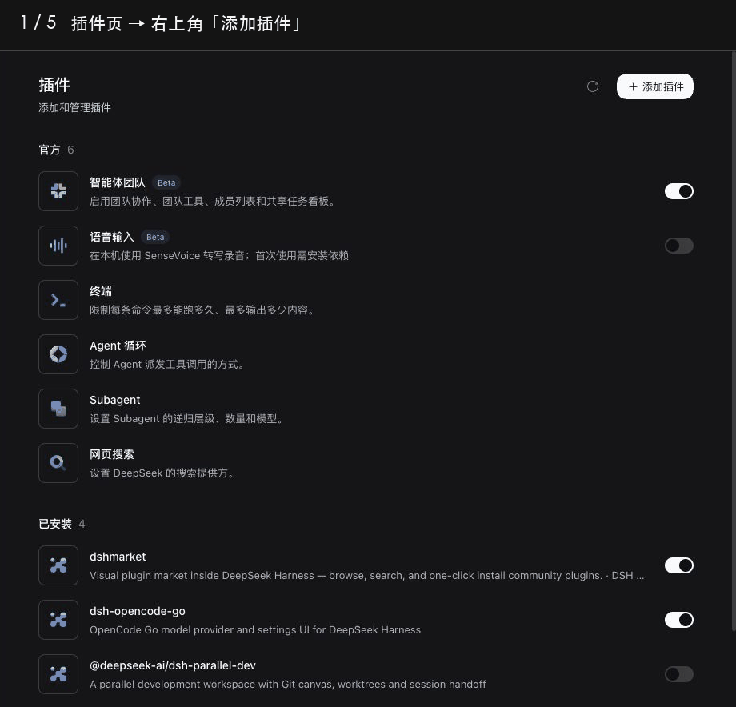
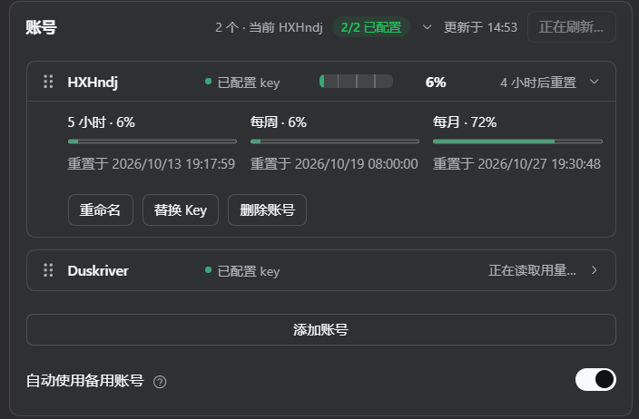
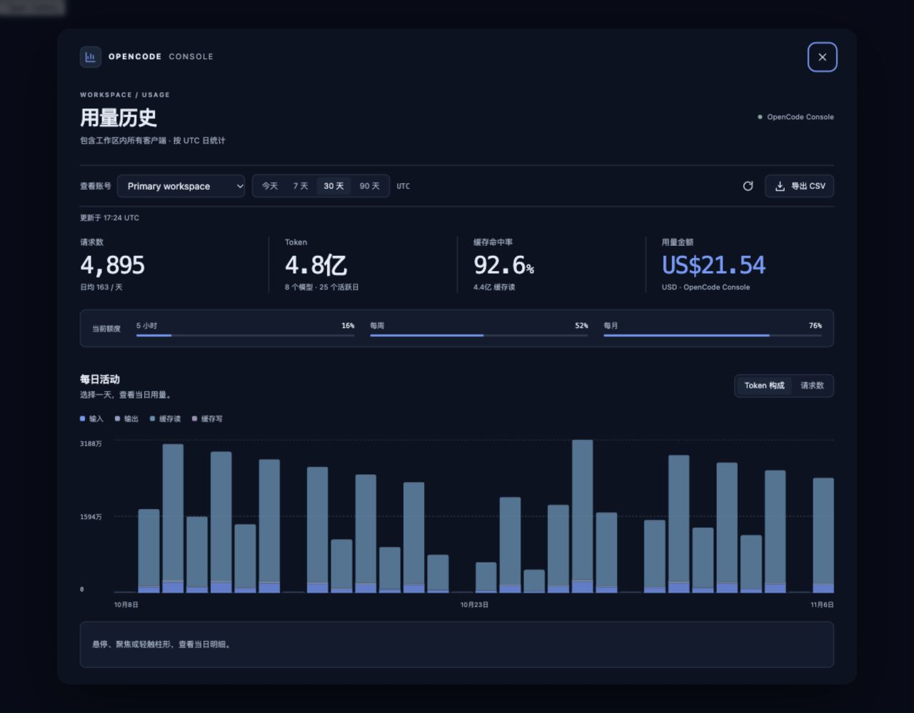
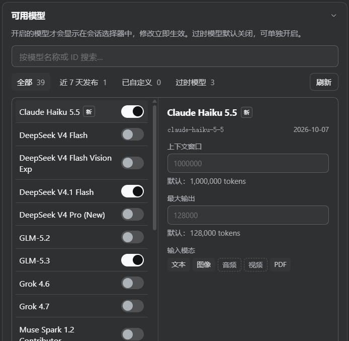
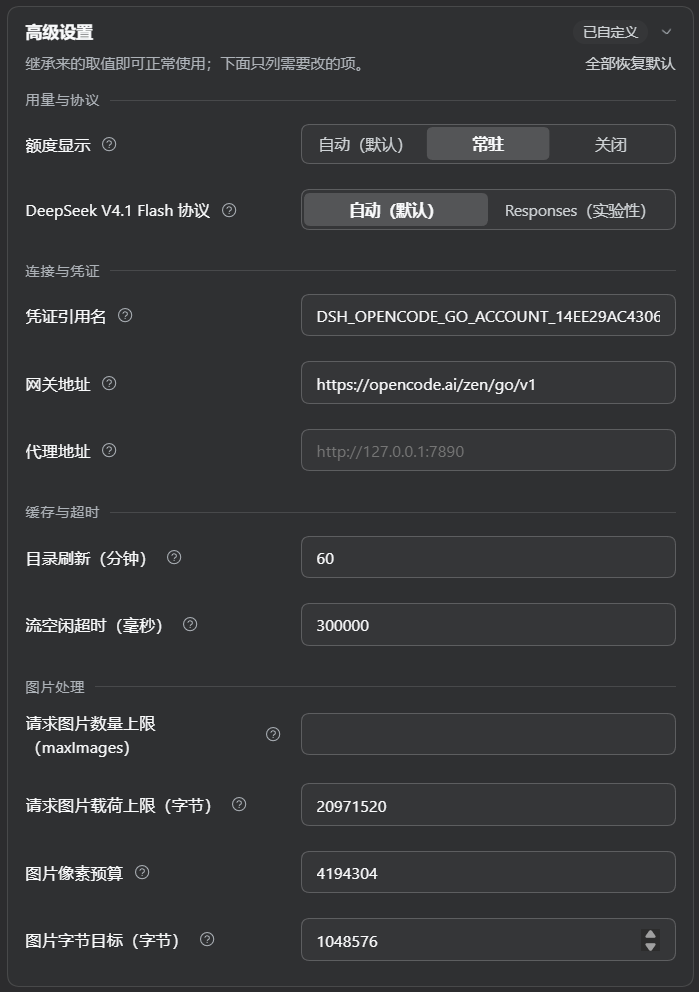

<p align="center">
  <picture>
    <source media="(prefers-color-scheme: dark)" srcset="docs/assets/logo-dark.png">
    
  </picture>
</p>

<h1 align="center">dsh-opencode-go</h1>

<p align="center">
  <a href="README.en.md">English</a> · <a href="#常见问题-faq">常见问题</a> · <a href="docs/advanced.md">高级指南</a> · <a href="docs/development.md">开发与测试</a>
</p>

为 [DeepSeek Harness (DSH)](https://github.com/deepseek-ai/deepseek-harness) 量身打造的 **OpenCode Go 专属接入与多账号管理插件**。

DSH 原生支持接入 OpenCode Go，但原生模式无法满足复杂的生产与日常开发需求（如多账号无感容灾、会话级 Prompt 缓存绑定、会话内实时额度透视等）。本插件基于 Cordis 微内核架构，在提供完整模型协议转换的同时，带来了流畅的客户端 UI 与企业级容灾体验。

文档中的现有界面截图展示 **Classic** 主题；默认的 **Native** 主题会跟随当前 DSH 的颜色、字体与几何 token。

---

## ✨ 核心特性

- 🆓 **双路由动态模型目录（Free 默认为关闭的 opt-in）**：Go 与平台免费模型分别从各自网关的 `/models` 发现，保留同名模型；平台免费通道（Free）默认关闭，需在 **设置 → OpenCode Go → 高级设置 → 免费通道** 显式开启后才注册路由、拉取目录并出现在模型选择器中；两套模型开关与容量设置独立。
- 🛑 **免费通道限流保护**：遵循上游 `Retry-After`，冷却期间暂停新请求；共享免费额度或 IP 限制不会触发 Go 换号。
- 🛡️ **多账号无感容灾**：支持最多 20 个账号集中管理与拖拽排序。当主账号额度耗尽或 Key 失效时，**在输出前自动尝试备用账号**，成功后自动扶正，告别“聊到一半额度没了”的打断感。
- ⚡ **会话级 Prompt 缓存绑定**：严格遵循网关协议注入专有 `x-opencode-session` 路由头，稳定复用网关上下文缓存，显著降低响应首字延迟。
- 📊 **会话内额度实时透视**：在聊天输入框旁常驻“用量胶囊”，直观展示 5 小时滚动、每周、每月的额度百分比及重置时间倒计时；支持休眠节能与静默刷新。
- 💰 **官方历史用量看板**：按所选 Key 的工作区汇总官方每日 CSV，查看请求、Token、官方用量金额与模型明细，包含其他客户端的调用。
- 🎛️ **模型与热配置**：无需重启 DSH！随时在线调整模型上下文窗口、最大输出上限、思考预算（Thinking Budget），并支持 HTTP/HTTPS/SOCKS5 代理。

---

## 🚀 快速开始

适用于 DSH `0.2.1-rc.5` 及以上版本；开发与验证方式见[开发说明](docs/development.md)。

### 1. 安装插件

#### 方式 A：在 DSH 界面中一键安装（推荐）
1. 打开 DSH，进入 **插件 → 添加插件**。
2. 输入 `dsh-opencode-go`（或填入仓库地址 `https://github.com/Duskriver/dsh-opencode-go`），点击 **安装**。
3. 安装完成后点击 **立即启用**。



#### 方式 B：命令行安装
```sh
dsh plugin --profile web add dsh-opencode-go
```
*命令行安装后请重启 `dsh web`。Headless 用户请使用 `--profile headless`。*

### 2. 配置与使用
1. 打开 **设置 → OpenCode Go → 账号**，点击添加，填写账号名称与 OpenCode Go API Key 后确认。
2. 在任意会话的模型选择器中，选择 **DSH OpenCode Go** 目录下的模型。
3. 开始对话，输入区右下角即可看到实时的用量胶囊。

---

## 💡 深度功能与运行机制

### 1. 多账号管理与无感容灾（Auto-failover）

在 **设置 → OpenCode Go → 账号** 中集中管理你的所有账号：



- **拖拽排序即优先级**：列表第一项为当前主账号；鼠标拖拽左侧手柄调整顺序，这个顺序也是自动尝试备用账号的优先次序。
- **出词前无感切换**：开启“自动使用备用账号”后，若当前账号在发出请求后遇到了 **401/403 鉴权失败、429 限流或 Quota 额度耗尽**：
  - 插件会在**开始向你输出文字前**，静默挑出下一个备用账号重新发送请求。
  - 成功出词的备用账号会自动移至首位成为新主账号，并在会话面板给出切换提示。
  - *防御机制*：若模型已经开始吐字或已产生计费，插件不会切换，避免拼接乱码或重复扣费。
- **防雪崩冷却黑名单**：被网关拒绝的 Key 会进入 5 分钟的内存冷却名单，避免短时间内反复向已失效的账号发起无意义的重试。
- **凭据安全隔离**：Key 直接存储至 DSH 底层凭据系统，前端界面永远不会回显明文密钥。

### 2. 会话内订阅额度透视（UsagePill）

在聊天输入区旁，常驻有直观的“用量胶囊”。点击即可展开完整的用量卡片：

- **三窗口精准监控**：
  - 🟢 **5 小时滚动配额**：短周期高频使用的健康度。
  - 🟡 **每周配额**：本周累计使用进度。
  - 🔴 **每月配额**：月度套餐消耗百分比。
  每个窗口均显示精确的重置倒计时；进度条会随着接近上限变黄，耗尽时变红。
- **节能与防抖机制**：默认每分钟静默刷新；当页面切入后台或浏览器最小化时**自动暂停轮询**，切换回前台时即时刷新。
- **账号全名与快速切换**：多账号时直接显示当前账号全名（名字过长以省略号截断），展开面板点击“切换”即可直接提拔目标账号为主账号。
- **显示模式**（在 **高级设置 → 额度显示** 中配置）：
  - **自动（默认）**：仅在使用 DSH OpenCode Go 模型时显示。
  - **常驻**：切换到其他厂商模型时，仍然保持胶囊显示。
  - **关闭**：隐藏胶囊并停止后台用量轮询。

### 3. 官方历史用量看板（Analytics）

从对话输入框的用量胶囊展开面板，或侧栏的看板按钮打开：



[窄屏浅色预览](docs/assets/usage-history-mobile.jpg) · [模型排行与明细预览](docs/assets/usage-history-models.jpg)（均为示例数据）

- **官方 CSV 单一来源**：请求、输入 / 输出 / 缓存 Token、官方用量金额、每日图表与模型明细来自同一份官方每日 CSV；provider + model 区分同名模型。支持今日、7 / 30 / 90 天，日期统一使用 UTC。
- **独立查看账号**：默认当前调用账号，只查看所选 Key 所属工作区，包含其他客户端；切换查看账号不改变对话账号。看板的三个额度窗口跟随所选账号。匿名 Free 覆盖不作保证。
- **官方用量金额**：直接汇总 `cost_micro_cents`（1 美元 = 1 亿单位），不等同于 Go 额外扣款。官方日汇总可能延迟。
- **双主题统一界面**：设置页、用量胶囊、侧栏与看板共用布局，通过 `appearanceTheme` 选择 **DSH Native（默认）** 或 **OpenCode Go Classic**，并跟随宿主明暗模式；主题差异见[分组高级设置](#分组高级设置)。宽屏弹窗、窄屏全屏，保留 Token 堆叠或请求日柱图、模型排行与明细。
- **按需查询**：打开、切账号、切区间或手动刷新时查询，Host 短缓存 30 秒，强制刷新绕过缓存，不后台轮询历史。仅官方模型网关支持历史查询；错误明确显示，不回退本地扫描。

Key 留在 Host；常规报告只向浏览器传递聚合数字与 provider / model / day。用户主动下载的官方 CSV 可包含成员字段。完整口径见[用量统计说明](docs/usage-analytics.md)。

### 4. 免费通道（Free，默认关闭的 opt-in）

`DSH OpenCode Free` 不是默认能力：为避免误用与合规风险，它默认关闭。需要时在 **设置 → OpenCode Go → 高级设置 → 免费通道** 打开开关并保存（或配置 `freeEnabled: true`）。关闭状态下插件不注册 `dsh-opencode-free` 路由、不请求 `freeBaseURL` 的模型目录，也不会在设置页的模型目录与模型发现中暴露 Free 模型；关闭开关并保存后该路由会撤回，进行中的请求允许完成。Go 通道与账号逻辑不受影响。

开启后：

- **复用已存账号（受端点绑定约束）**：Free 与 Go 共用账号列表，但只有在 `freeBaseURL` 的 hostname 为 `opencode.ai`（官方平台地址），或与当前 `baseURL` 同 origin（协议 + 主机 + 端口完全一致，例如自建反向代理同时承载两个路由）时，才会复用已存账号 Key 并遵循“自动使用备用账号”设置；其它自定义 `freeBaseURL` 一律退回匿名公共访问（`Bearer public`），不读取也不发送任何已存 Key，并记录不含密钥的诊断信息。
- **无 Key 时匿名公共访问**：没有可用 Key 时以 `Bearer public` 发起匿名公共访问。
- **官方 CLI 身份**：请求以官方 OpenCode CLI 的 `opencode/latest/2.2.5/cli` User-Agent 发出，而不是 DSH 自身的归属 UA。
- **独立 Bun 运行时**：Free 推理通过 `optionalDependencies` 中版本锁定为 1.4.4 的官方 `@oven/bun-*` 平台包启动独立 HTTP worker。平台包直接提供原生二进制，不需要 `bun` 包装包或其 `postinstall`，因此无需批准 Bun 构建脚本；缺少可选依赖时的表现见下方 FAQ。
- **限流保护**：遵循上游 `Retry-After`，冷却期间新请求直接返回 `FREE_COOLDOWN`；共享免费额度 / IP 限制不会触发 Go 换号。

> ⚠️ **风险提示**：Free 通道依赖上游公开的免费入口并以官方 CLI 身份发出请求，可能违反 OpenCode / 上游服务条款，也可能触发上游风控、限流或账号限制。是否开启以及使用频度由你自行判断并承担风险；请勿在生产环境或大规模自动化调用中使用。

---

## 🛠️ 架构设计与工作原理

源码按领域组织，宿主与浏览器通过 DSH Typert RPC 通讯：

```text
src/
├── index.ts + config.ts          插件挂载、configure 设置与热更新
├── contracts.ts                 浏览器可用的配置、模型与 RPC 契约
├── adapter.ts                   请求执行、会话头、容灾与冷却
├── catalog.ts                   模型目录与公共元数据缓存
├── conversion.ts                上下文、单次请求图片预算、回放与流转换
├── google.ts + sdk-types.ts      Google SDK 接入与公开类型
├── accounts.ts                  串行账号命令、凭据写入与官方配额
├── analytics.ts                 官方每日 CSV、历史聚合与短缓存
├── transport.ts                 HTTP/HTTPS/SOCKS5、超时与脱敏错误
└── client/
    ├── index.ts + controller.ts  configForms 接入、类型化草稿与账号操作
    ├── Section.tsx              宿主设置页、账号卡片与模型编辑器
    ├── UsagePill.tsx            会话额度胶囊
    ├── AnalyticsDialog.tsx      官方历史用量看板
    └── presentation.ts          多语言、Native / Classic 主题 token 与显示格式
```

账号操作在内存串行队列中直接更新凭据与设置。模型容量草稿始终保留为对象；图片按单次请求限制数量、编码字节及最多四路并行准备。宿主仅使用 DSH `0.2.1-rc.5` 起提供的设置与图片卸载接口。包的 `.` 与 `./client` 导出路径保持不变。

### 为什么必须要携带 `x-opencode-session`？
OpenCode Go 网关具有会话粘性路由与上下文缓存共享能力。插件会把 DSH 对话 ID 规范化为稳定的 `x-opencode-session` 请求头：常见的可打印 ASCII 会话 ID **原样透传**，只有包含非常规字符（非可打印 ASCII）或恰好占用插件内部保留前缀的 ID 才会做 sha256 + base64url 单向散列；两种形式都不含对话正文。目的只是让多轮对话始终落在同一推理节点上，最大化命中网关的 Prompt Cache，显著节省思考与生成时间。

---

## ⚙️ 模型自定义与高级配置

### 模型参数覆盖
进入 **设置 → OpenCode Go → 可用模型**：



- **显示开关**：自由隐藏不常用的模型，净化聊天选择器。
- **容量与上下文覆盖**：可手动指定上下文窗口（Context Window）与单次最大输出 Token。
- **思考预算（Thinking Budget）**：对支持深度思考的模型，可自定义思考强度等级或 Token 预算。
- **默认输出预算**：任意模型声明的输出上限超过 65,536 且调用方与设置均未显式指定时，默认封顶 **65,536 tokens**；较小模型保留 SDK 默认值。该预算同时报告给 DSH，用于上下文压缩。

### 分组高级设置
支持在 **设置 → OpenCode Go → 高级设置** 中按需微调：



- **界面主题**：在 **用量设置 → 外观** 中将 `appearanceTheme` 设为 `native` 或 `classic`。**Native（默认）** 通过 Host 公开语义 token 跟随 DSH 与第三方主题的颜色、字体、圆角、阴影和焦点样式，token 不可解析时使用中性 fallback；其中强控件边界与图表状态系列（输出 / 缓存读 / 缓存写）保持插件自有的对比度受控色值，不跟随 Host 或第三方调色板——Host 的 `border-l2` 是发丝分隔线、`state-*` 是状态点色，都不保证控件边界与图表所需的 WCAG 1.4.11 3:1；品牌强调色图表系列仍跟随 Host 强调色。未设置该字段的旧配置也缺省使用 Native。**Classic** 保留暖纸 / 炭灰、陶土色强调与 Anthropic Serif / Sans / Mono、中文衬线回退，不跟随 Host 或第三方主题覆盖这些品牌 token，但仍按宿主明暗模式切换 Classic 配色。输入栏额度样式仍为 `badge`（默认）/ `plain`，侧栏额度显示仍是独立开关且默认关闭。
- **网络代理**：支持填入 HTTP、HTTPS 或 SOCKS5 代理地址（如 `socks5://127.0.0.1:1080`），保存后即时应用于对话、用量查询与模型刷新。
- **超时控制**：分别支持配置请求准备超时（`requestPreparationTimeoutMs`）、整轮请求超时（`requestTimeoutMs`）以及流空闲看门狗阈值（`streamIdleTimeoutMs`）。
- **免费通道（opt-in）**：默认关闭；开启后注册 `DSH OpenCode Free` 路由、拉取平台免费模型；已存 Key 仅在 `freeBaseURL` 为官方域名或与 `baseURL` 同 origin 时复用，否则退回匿名公共访问；关闭后该路由撤回，进行中的请求允许完成。
- **一键恢复默认**：点击每张卡片的“全部恢复默认”可一键清空自定义覆盖，不影响已保存的账号 Key。

---

## ❓ 常见问题 (FAQ)

<details>
<summary><strong>Q: 为什么聊天输入区没有出现用量胶囊？</strong></summary>

1. 检查当前会话选中的模型是否为 **DSH OpenCode Go** 分组下的模型。默认“自动”模式仅在选择本插件模型时展示；若希望在使用其他模型时也看到配额，可在 **高级设置 → 额度显示** 中切为“常驻”。
2. 检查是否已在设置中填入有效 API Key 且插件已处于启用状态。
</details>

<details>
<summary><strong>Q: 为什么在模型选择器里找不到 DSH OpenCode Free 模型？</strong></summary>

Free 通道默认关闭（显式 opt-in）。请到 **设置 → OpenCode Go → 高级设置 → 免费通道** 打开开关并保存；只有开启后插件才会注册 Free 路由、拉取 Free 模型目录并在模型选择器中显示。Free 与 Go 共用账号，但请求会以官方 OpenCode CLI 的 User-Agent 发出，可能触发上游风控 / 限流，也可能违反上游条款，请自行评估并承担风险。
</details>

<details>
<summary><strong>Q: Free 通道为什么需要额外的 Bun 运行时？</strong></summary>

Free 推理直接使用 `optionalDependencies` 中版本锁定为 1.4.4 的官方 `@oven/bun-<platform>` 平台包启动独立 HTTP worker。平台包直接携带原生二进制，没有安装脚本，也不需要批准 `bun` 的 `postinstall`；包管理器只安装与当前系统、CPU 和 libc 匹配的运行时。若可选依赖被 `--omit=optional` 省略或未能安装，Free 会报 `MISSING_BUN_RUNTIME`，重新安装插件并启用 optional dependencies 即可恢复；Go 通道完全不受影响。Free 默认关闭并不会自动省略这项可选运行时下载。
</details>

<details>
<summary><strong>Q: 为什么长会话中偶尔会报 400 错误？</strong></summary>

通常是因为单次上下文加输出预算超过了模型允许的 Context Window。建议：
1. 在会话中执行 `/compact` 指令压缩历史消息。
2. 或在 **可用模型** 设置中，适度调低该模型的“最大输出”上限。
明确的上下文超限错误会被插件捕获并交由 DSH 原生恢复机制处理。
</details>

<details>
<summary><strong>Q: 升级插件后，旧会话找不到模型怎么办？</strong></summary>

从 `0.1.16` 及更早版本升级时，底层 Provider ID 进行了规范化统一。只需在旧会话或 Agent 配置的模型下拉框中，重新选择一次 **DSH OpenCode Go** 下的模型即可。
</details>

<details>
<summary><strong>Q: 插件在执行过程中会自动将我的数据上传到第三方吗？</strong></summary>

正常对话会把请求内容发送到你配置的模型网关（默认为 OpenCode Go 官方网关），额度查询也会访问该网关。插件从 Go 与平台网关各自的 `/models` 下载公开的模型能力与价格；默认地址分别为 `https://opencode.ai/inference/go/v1` 与 `https://opencode.ai/inference/v1`。

历史看板由 Host 使用所选 Key 请求官方 Console 的每日 CSV，仅支持官方模型网关配置，沿用代理设置。浏览器常规报告只收到聚合数字与 provider / model / day，不含 Key、会话正文或成员字段；主动下载的官方 CSV 可包含成员字段。模型发现请求不携带会话正文、账号密钥或逐条统计记录。
</details>

---

## 📦 更新与卸载

### 更新插件
```sh
dsh plugin --profile web update dsh-opencode-go --latest
```
更新后重启 `dsh web` 并刷新浏览器页面（桌面客户端请完全退出后重新打开）。

### 卸载插件
```sh
dsh plugin --profile web remove dsh-opencode-go
```

---

## 🧪 开发与验证

使用 Node.js `^22.19.0 || >=24.0.0`，开发依赖锁定 DSH `0.2.1-rc.5`、Cordis `4.0.5`；宿主 Cordis 要求 `^4.0.5`。

```sh
npm ci
npm test
npm run typecheck
npm run check:dist
npm run check:pack
npm run verify
```

测试按领域覆盖宿主、协议转换、账号、统计、传输、免费通道退避、前端。修改源码后先运行 `npm run compile` 更新 `lib/`；`verify` 包含类型检查、产物一致性、全量测试与包加载冒烟。独立安装和 Headless 验证见[开发说明](docs/development.md)。

---

## 📚 更多文档与链接

- 📖 [高级使用指南（Headless 部署、代理策略与错误排查）](docs/advanced.md)
- 📊 [用量看板统计说明（官方来源、口径与隐私）](docs/usage-analytics.md)
- 🛠️ [开发与贡献指南](docs/development.md)
- 🧪 [验收范围与验证记录](docs/verification.md)
- 🐛 [提交 Issue 与建议](https://github.com/Duskriver/dsh-opencode-go/issues)
- 📄 [MIT 开源许可证](LICENSE)
