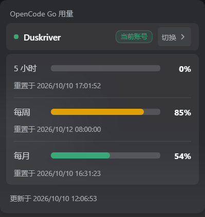
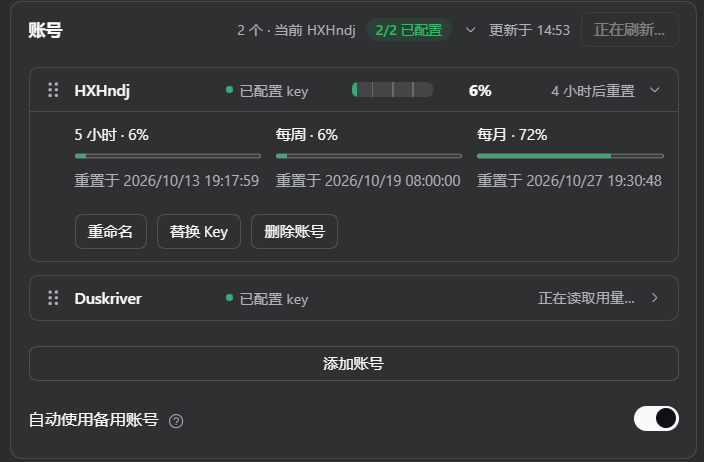
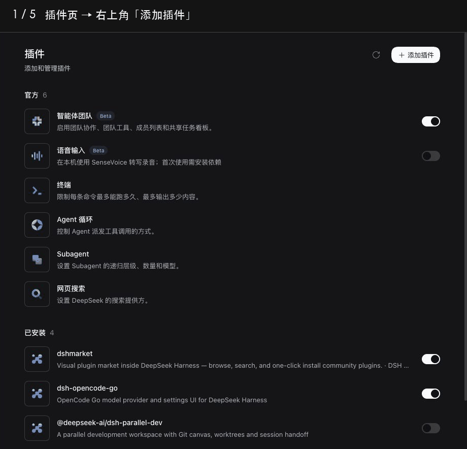
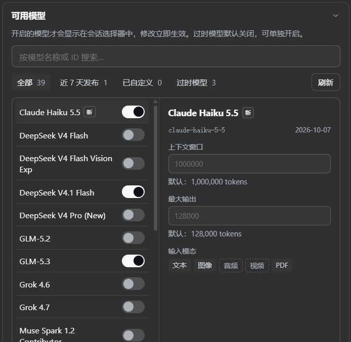
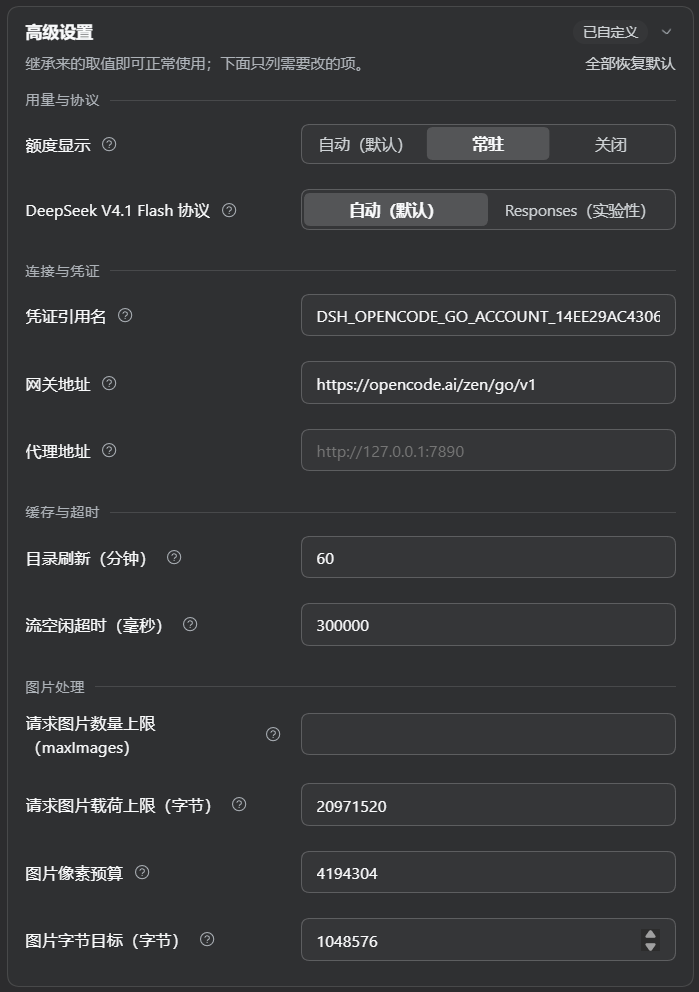

# dsh-opencode-go

[English](README.en.md)

为 [DeepSeek Harness](https://github.com/deepseek-ai/deepseek-harness) 提供 **OpenCode Go 订阅用量查看与多账号管理**，让额度、重置时间和账号切换更方便。

DSH 已支持原生接入 OpenCode Go。本插件重点提供会话内用量查看、多账号管理，以及独立的模型与设置界面。

- **用量随手可查**：在会话输入区查看用量，展开查看 5 小时、每周、每月已用百分比与重置时间。
- **多个账号集中管理**：查看各账号额度和 Key 状态，拖动排序，在会话中手动切换，也可开启自动使用备用账号。
- **模型与设置更直观**：搜索和筛选模型，调整显示、容量与思考预算；高级设置按用途分组，提供提示与恢复默认操作。

支持中文和英文，跟随 DSH 的界面语言。

## 查看订阅用量

点击会话输入区旁的用量胶囊，展开当前账号的订阅用量。进度条显示**已用百分比**，接近上限时变为黄色，耗尽时变为红色；每个额度窗口都显示重置时间。



显示用量时每分钟自动刷新；页面进入后台时暂停周期查询，回到前台后刷新。暂时查询失败时，面板会提示失败，并在可保留上次数据时标明“上次数据”，可点击“立即重试”。也可以在设置页的账号卡片中点击 **刷新额度**。

在 **设置 → OpenCode Go → 高级设置 → 额度显示** 中选择：

| 模式 | 行为 |
| --- | --- |
| 自动（默认） | 选中 **DSH OpenCode Go** 模型时显示 |
| 常驻 | 使用其他模型时也显示已配置的 OpenCode Go 账号用量 |
| 关闭 | 隐藏会话用量胶囊并停止其轮询 |

## 用量看板

在会话用量面板底部点击 **用量统计**，或在 **设置 → OpenCode Go → 用量统计** 中打开同一份看板。它统计**本插件路由**的请求（含已关闭会话），按模型汇总输入、输出与缓存 token，并用 models.dev 的 Go 套餐价格估算金额。

- 区间：今天、7 天、30 天、90 天；打开时扫描本地会话，不上传，关闭弹窗即停止。
- 金额按请求开始时间计价；DeepSeek V4.1 Flash / V4 Pro 在官方峰时（UTC 周一至周五 01:00–04:00、06:00–10:00）按平峰价的两倍计算。
- 模型行只显示名称与请求 / Token / 花费 / 占比；官方额度百分比仍是权威值，估算金额不是账单。
- 默认最多扫描 500 个会话、50 万个事件、12 秒；结果不完整时会明确提示并标注成因，可点击 **扫描更多历史**（最多 2000 个会话，该选择保存在本地）。已关闭会话的折叠结果会按日志 revision 缓存在本地，重启后再次打开只需读取变更过的会话。
- DSH 原生 OpenCode Go 路由不计入；0.1.16 之前的旧路由记录按其请求时间回收。宿主未提供 `sessionQuery` 时显示不可用。

**主题**：在 **设置 → OpenCode Go → 用量统计** 展开后的「主题」一栏切换 **寂静黑 / 石墨（默认）/ 海盐青 / 暖砂**，四张小样直接显示各自的配色。主题跟随 DSH 的明暗模式，偏好保存在本地；胶囊面板和看板里不再单独提供切换。胶囊不再带 `Go ·` 前缀；多账号时直接显示当前账号全名，名字过长时以省略号截断，完整名字保留在按钮标题和展开面板中。

详细口径与限制见[用量统计说明](docs/usage-analytics.md)。

## 管理多个账号

在 **设置 → OpenCode Go → 账号** 中集中管理账号：



- 添加账号、重命名、替换 Key 或删除账号；最多支持 20 个账号。
- 每行查看 Key 状态、5 小时已用百分比和重置倒计时，展开查看完整用量与账号操作。
- 拖动行首手柄调整顺序，第一行成为当前账号；顺序也决定自动尝试备用账号的次序。
- 在会话用量面板中点击 **切换**，将所选账号移至首位，供本 profile 后续请求使用；其他账号的相对顺序保持不变。

开启 **自动使用备用账号** 后，当前账号额度耗尽或 Key 不可用时，插件会在开始输出前按顺序尝试其他账号。开始正常输出的备用账号会移至首位并成为当前账号，用量面板会显示切换提示。请求已经输出、产生 token 用量或被取消后，不会自动切换账号重发。

Key 通过 DSH 凭据服务保存，设置页不会回显已保存的密钥。

## 安装与快速开始

适用于 DSH `0.1.5-rc.1` 及以上版本。已验证的宿主版本见[兼容矩阵](docs/development.md#installed-package-matrix)。

### 在 DSH 中安装

1. 打开 **插件 → 添加插件**。
2. 输入 `dsh-opencode-go`，点击 **安装**。
3. 安装完成后点击 **立即启用**。



也可以在添加插件时输入仓库地址：

```text
https://github.com/Duskriver/dsh-opencode-go
```

命令行安装：

```sh
dsh plugin --profile web add dsh-opencode-go
```

命令行安装后启动或重启 `dsh web`。Web 和 Headless 使用各自的 profile，分别安装和更新。

### 开始使用

1. 打开 **设置 → OpenCode Go**，填入 OpenCode Go 订阅的 API Key 并保存，或在 **账号** 中添加账号。
2. 在会话模型选择器中选择 **DSH OpenCode Go** 下的模型。
3. 开始对话，在输入区旁查看用量；有多个账号时可展开面板切换。

插件使用独立的模型提供方 **DSH OpenCode Go**。选择 DSH 原生提供的模型不会自动使用本插件的账号切换功能；“常驻”模式仍可展示本插件已配置账号的用量。

## 模型与设置

### 选择模型与调整参数

在 **可用模型** 中按名称或 ID 搜索，也可以筛选 **近 7 天发布**、**已自定义** 或 **过时模型**。点击 **刷新** 核对最新模型目录。



- 模型开关控制它是否出现在会话选择器中，修改立即生效。
- 选中模型可查看目录提供的上下文窗口、最大输出和输入模态，容量覆盖保存后生效，留空使用默认值。
- 支持思考的模型提供相应开关、强度或 token 预算选项；预算式模型还可添加自定义预算并保存。

`deepseek-v4.1-flash` 每次请求默认使用 **64k（65,536 tokens）** 的输出预算，模型输出上限更小时取较小值，并将该默认值告知 DSH 用于计算压缩时机。该规则只应用于此模型；其他模型沿用 SDK 的默认输出行为。需要更长回答时，可在模型容量覆盖中设置「最大输出」。

流式回复、思考、工具调用和图片输入取决于模型能力。界面中的输入模态来自在线模型配置；本插件目前仅转换并转发图像附件。

### 分组高级设置

高级设置按 **用量与协议**、**连接**、**缓存与超时**、**图片处理** 分组。悬停问号查看说明，可通过 **全部恢复默认** 清除该卡片的自定义覆盖，再保存修改；当前账号选择保持不变。



支持 HTTP、HTTPS 和 SOCKS5 代理，保存后用于后续对话、模型目录更新与用量查询。代理运行在 DSH 所在的机器上；远程部署中的 `127.0.0.1` 指服务器自身。

DeepSeek V4.1 Flash 的 Responses 协议选项为实验性，仅影响新请求，不承诺更低延迟。完整配置与使用说明见[高级使用指南](docs/advanced.md)。

截图用于展示界面，具体模型、额度和时间以当前账号与在线目录为准。

## 更新与常见问题

更新到 npm 最新发布版本：

```sh
dsh plugin --profile web update dsh-opencode-go --latest
```

更新后重启 `dsh web` 并刷新页面；桌面版完全退出后重新打开。Headless 用户将 `web` 换成 `headless`。仓库默认分支可能包含尚未发布到 npm 的修改。

**为什么没有显示用量？** 默认“自动”模式仅在选择 **DSH OpenCode Go** 模型时显示。请检查插件是否启用、Key 是否配置，以及额度显示模式；使用其他提供方时可选择“常驻”。

**查询失败或添加账号中断怎么办？** 用量查询可在面板中重试，或在账号卡片中刷新额度。未成功保存 Key 的新增账号可补填 Key 或删除；账号操作的恢复机制见[高级使用指南](docs/advanced.md#账号操作与保存)。

**长会话持续报 400 怎么办？** 检查错误中的输出预算与上下文窗口，可执行 `/compact` 或调低该模型的「最大输出」后重试。明确的上下文超限会交给 DSH 的恢复机制；原因不明的 400 会保留原分类并给出排查建议。失败且未取得 token 用量时，插件不发送全零用量，避免将上下文占用误报为 0%。

**升级后旧会话找不到模型？** 从 `0.1.16` 及更早版本升级时，在旧会话或 Agent 预设中重新选择 **DSH OpenCode Go**；手动配置使用 `provider: dsh-opencode-go`。

**兼容性范围是什么？** 安装兼容性覆盖十个宿主版本，从 `0.1.5-rc.1` 到 `0.2.1-alpha.1`，后续版本仍需验证。目前明确拒绝 developer 消息、动态工具增删和延迟工具加载，详见[开发与兼容性说明](docs/development.md)。

卸载：

```sh
dsh plugin --profile web remove dsh-opencode-go
```

## 更多文档

- [高级使用指南：Headless、代理、手动配置与错误诊断](docs/advanced.md)
- [用量统计说明：口径、计价、扫描上限与隐私](docs/usage-analytics.md)
- [开发与测试](docs/development.md)
- [验证记录](docs/verification.md)
- [问题与建议](https://github.com/Duskriver/dsh-opencode-go/issues)
- [MIT 许可证](LICENSE)
